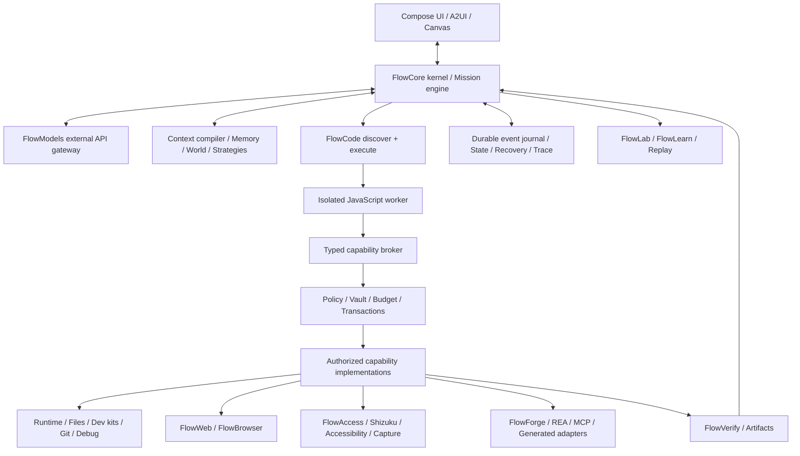

# ONEFLOW — Master Engineering Specification & Coding Agent Instructions

**Revision:** 1.0 · 2026-11-26  
**Status:** approved product scope; implementation and feasibility testing outstanding  
**Audience:** the coding agent responsible for building Oneflow from an empty or existing repository  
**Deliverable:** a real, standalone Android application, built incrementally in verified phases  
**Product principle:** Simple wins. Simple outside, powerful inside.

> Bismillah. Build carefully, understand before coding, verify before claiming success. This document is the complete project brief and primary source of truth. It is an engineering plan, not proof that any integration has been implemented. Names and example APIs below are Oneflow design contracts unless explicitly identified as upstream APIs. Validate upstream versions and device behavior before relying on them.

## Contents

1. [Instructions to the implementation agent](#1-instructions-to-the-implementation-agent)
2. [Product scope and non-goals](#2-product-scope-and-non-goals)
3. [Architecture and repository](#3-architecture-and-repository)
4. [Agent kernel, missions and intelligence](#4-agent-kernel-missions-and-intelligence)
5. [Model gateway](#5-model-gateway)
6. [FlowCode and tool contracts](#6-flowcode-and-tool-contracts)
7. [Security, permissions and isolation](#7-security-permissions-and-isolation)
8. [State, context, memory and learning](#8-state-context-memory-and-learning)
9. [Runtime, packages and development kits](#9-runtime-packages-and-development-kits)
10. [FlowWeb and FlowBrowser](#10-flowweb-and-flowbrowser)
11. [Android computer use](#11-android-computer-use)
12. [FlowForge, REA and FlowTeach](#12-flowforge-rea-and-flowteach)
13. [Teams, automation, interoperability and sync](#13-teams-automation-interoperability-and-sync)
14. [UI, onboarding and workspace](#14-ui-onboarding-and-workspace)
15. [Data, observability, testing and release](#15-data-observability-testing-and-release)
16. [Phased implementation plan](#16-phased-implementation-plan)
17. [Reference library](#17-reference-library)
18. [Final instructions and phase report](#18-final-instructions-and-phase-report)

---

## 1. Instructions to the implementation agent

Act as the principal Android engineer, harness engineer, runtime/security engineer, product designer, QA lead and technical researcher. You are implementing **Oneflow**, not wrapping an existing agent CLI. The owner wants the full vision below built in phases. Start executing Phase 0, not merely restating this document. Do not build a giant fake UI or install unrelated packages. Do not attempt every phase simultaneously.

### 1.1 Working agreement

- Inspect the repository, git status, available SDK/NDK/JDK, compiler versions, device/emulator availability and existing instructions before edits. Preserve existing user changes; never reset unrelated work.
- Create or update `AGENTS.md` with a concise navigation map and non-negotiable rules. Keep this file as `docs/ONEFLOW_MASTER_BUILD_SPEC.md` in the repository. Create `docs/IMPLEMENTATION_STATUS.md`, `docs/DECISIONS.md`, `docs/COMPATIBILITY.md`, `docs/THREAT_MODEL.md`, `docs/DEPENDENCIES.md`, and `docs/TEST_EVIDENCE.md` as evolving implementation records, not replacements for this brief.
- Research actual upstream source, docs, releases, license and tests before integrating. Record commit/tag, URL, relevant source paths, target ABI, assumptions, license obligations and fallback. Use upstream APIs rather than fictional function names. Do not silently copy GPL/AGPL code into an incompatible distribution; get a licensing decision or independently implement the concept. Do not ship proprietary components without rights.
- Start with the smallest end-to-end vertical slice; each phase must compile, be demonstrable and have automated tests. Wire real behavior before showing a UI feature as available. Feature flags and explicit unavailable states are acceptable; fake success is not.
- Default to proceeding autonomously on routine, reversible, authorized engineering work. Ask only when blocked on essential user decisions, credentials, Android consent, sensitive actions, spending, distribution or material security tradeoffs. Never silently bypass OS permission prompts, security controls, service access restrictions or third-party licenses.
- Use incremental git commits, topic branches/worktrees for experiments and rollback checkpoints. Do not push, publish, deploy, sign with a production key, or alter external accounts without authorization.
- On an engineering failure, capture reproduction, inspect logs and sources, form a hypothesis, run the smallest discriminating experiment, fix the root cause, retest and document. Avoid blind retries, arbitrary dependency downgrades, security disabling and wholesale rewrites.
- Every test claim must state command, environment, result and evidence. Distinguish mock tests, host tests, emulator tests and physical-device tests. A missing credential or device is a blocker, not a pass. Do not store real API keys, account data, private screenshots or production credentials in git or logs.
- Maintain backward-compatible storage migrations and public tool schemas. Use pinned dependency versions, lockfiles/checksums, reproducible builds and minimal dependency surface.
- When resuming a session, read current status, last commit, open blockers, test evidence and this spec. Reconcile actual repository/device state before continuing. Do not repeat completed side effects.
- Do not fabricate estimates, benchmarks, integrations or release dates. Keep a phase-by-phase checklist with `NOT_STARTED`, `IN_PROGRESS`, `BLOCKED`, `VERIFIED`. A feature is only verified after its acceptance gate passes.

### 1.2 Engineering method

For each vertical slice: understand → design the contract → write tests/fixtures → implement → run → inspect → verify → commit → document. Use explicit acceptance criteria. Prefer tests and typed interfaces over prompt-only guarantees. Use feature flags for experimental integrations, and make failure states visible. The app must still operate if optional integrations are absent. Do not add a new service merely because this document gives a feature a Flow name.

### 1.3 Decisions that require feasibility evidence

The following are not proven: executing downloaded native tools under a modern Android target SDK; a sufficiently isolated local native shell; QuickJS async JNI integration and robust cancellation; local Android SDK build toolchain; REA's complete ARM64/Android provider support; WebView multi-profile behavior; access to AppFunctions; Android/OEM-specific Shizuku methods; unrestricted always-on execution. Prototype these early. If a hard constraint cannot be satisfied, keep the affected capability unavailable or use an explicitly authorized optional remote worker, record the blocker, and do not weaken platform security. A fully local core remains mandatory.

---

## 2. Product scope and non-goals

### 2.1 Vision

Oneflow is an agent-native Android workstation: an independent agent harness with bring-your-own model API, a programmable tool layer, native development tools, research and browser workspace, authorized Android computer use, an agent-native tool builder, persistent missions, and a minimal professional interface. The model reasons; our harness owns state, execution, permissions, feedback and delivery. It is not a chatbot UI around somebody else's agent.

Example user goal: “Build a native Android app, research the current libraries, implement the screens, run the build, install and test it, fix the failures, then show me the result and evidence.” Oneflow should select tools, adapt, execute locally when available, verify and report blockers honestly. Simple questions do not require elaborate mission planning.

### 2.2 Required scope

| Area | Requirements |
|---|---|
| Intelligence | Independent Kotlin agent kernel, OpenAI-compatible APIs, adaptive strategies, context compiler, persistent memory, goal completion, multi-agent collaboration, user steering |
| Execution | Code Mode first, QuickJS candidate, typed capability broker, native tools, transactions, durable state, verification and recovery |
| Development | Musl/Bionic runtime, modular dev kits, terminal, editor, file manager, Git, LSP/DAP, project detection, previews, APK build/test where validated |
| Research | Keyless/free search and fetch, local index, evidence and citations, deep research, native WebView browser with Ego-inspired spaces/snapshots |
| Computer use | Shizuku, Accessibility, MediaProjection, programmatic/semantic/visual routing, live takeover and permission onboarding |
| Builder | REA, FlowForge, authorized source/binary analysis, generated adapters, FlowTeach demonstrations, agent-native SDK |
| Ecosystem | MCP, Agent Skills, AGENTS.md, OpenAPI, A2UI, later ACP and A2A, experimental WebMCP/AppFunctions, extension store |
| Reliability | Sandbox, policy, vault, budget, world state, guard, event journal, replay, tracing, evaluation, signed packages, recovery, optional encrypted sync |
| Experience | Native Compose AMOLED design, chat, missions, canvas, editor, terminal, browser, artifacts, settings, command palette, multimodal attachments, notifications |

### 2.3 Non-goals and fixed choices

- **No marketing features**: no lead generation, ads, SEO/ASO, CRM, outreach/email campaigns or social growth automation kits.
- **No local AI models**: no bundled weights, llama.cpp, LiteRT-LM, Gemini Nano, local embeddings, GPU/NPU inference or local vision LLMs. Reasoning, vision and optional semantic embeddings use user-configured external APIs; default retrieval uses deterministic text/symbol search. Standard OS utilities for audio input/output and document extraction are fine. Do not add a required local AI inference dependency. A user-hosted compatible API on a separate computer/server is acceptable, not an on-device inference system.
- No mandatory Antigravity, Claude Code, OpenCode, Codex, Pi, Antigem, Termux, PRoot, root access, desktop browser or server. External agent adapters come later. Shizuku is optional for system capabilities, not a core boot dependency.
- No paid web search/extraction API requirement. Free public endpoints, feeds, local tools and optional self-hosted metasearch are acceptable; external model API fees and optional infrastructure costs are separate. No promise of unlimited free search or undetectability. Do not bypass CAPTCHA, access denials, paywalls or service abuse controls; stop, use permitted sources, or hand control to the user.
- No unlimited hidden background execution, automatic permission granting, unbounded autonomous loops, or unrestricted privileged code. “Autonomous” means operate within a defined scope and budget, with visible controls and necessary consent.
- Do not prioritize an APK deliverable before validated implementation. Build debug APKs as part of testing when ready, not as a substitute for the harness.

### 2.4 Target assumptions (proposed, validate in Phase 0)

Android ARM64 first, modern target SDK appropriate to release channel; suggested minSdk 26 or higher after testing dependency requirements, with capability gating by OS/WebView features. Test on arm64 physical devices across Android 11–17 where available, plus host and emulator tests; newer optional features must not prevent app startup on older supported versions. Developer Edition distributed directly (e.g. GitHub releases) and a separate restricted Play-compatible flavor only after policy review. No promise of Play Store approval. Favor native app-private workspace and user-selected Storage Access Framework (SAF) folders. Device resource usage and external API cost must be visible and bounded.

---

## 3. Architecture and repository

### 3.1 Logical architecture



This is a modular monolith with explicit ports and adapters plus isolated workers/services where required. No microservices explosion. `Flow*` names are logical product capabilities, not all independent Gradle modules. Dependencies point toward core contracts, never Android UI into core. Policy is enforced at actual host operation boundaries, not only at the model or JS layer. Platform-specific APIs sit behind ports; core has no Android imports.

### 3.2 Stack decisions

| Concern | Default choice / alternative condition |
|---|---|
| Language | Kotlin/JVM core; Kotlin Android app; C/C++ JNI for engine/native launcher |
| UI | Jetpack Compose + Material 3 primitives with custom monochrome design tokens, AndroidX Navigation, adaptive layouts |
| Build | Gradle Kotlin DSL, version catalog, Android Gradle Plugin, pinned compatible JDK/NDK, CMake for JNI |
| Async | Coroutines, structured concurrency, Flow/StateFlow, bounded dispatchers, cancellation propagation |
| Data | kotlinx.serialization; SQLite/Room Android adapter; JVM storage adapter for host tests; FTS5 where supported |
| Networking | OkHttp, streaming SSE, TLS, explicit deadlines; Ktor only where justified by integration |
| DI | Constructor injection first, Hilt at Android composition root if justified; no global mutable service locator |
| JS | QuickJS-NG pinned source/JNI candidate; process isolation mandatory for untrusted scripts |
| Native tools | Bionic/NDK, musl-compatible ARM64 executables, approved package mechanism validated per ABI/OS |
| Code intelligence | Tree-sitter, ripgrep, LSP, DAP, ast-grep; optional static analyzers |
| Browser | Android System WebView, AndroidX WebKit, controlled DOM/semantic interface; CDP only for authorized debugging |
| Web | Native search adapters, optional DDGS/SearXNG, jsoup, Mozilla Readability, optional Trafilatura/MarkItDown |
| Security | Android Keystore-backed credential vault, SAF, isolated processes, typed grants, redaction, signed artifacts |
| Standards | JSON Schema, MCP, Agent Skills, AGENTS.md, OpenAPI, A2UI; ACP/A2A/WebMCP later |
| Tests | JUnit, coroutine test, MockWebServer, JVM fixtures, Android instrumentation/Compose, native tests, security regression, external benchmarks |
| Trace | structured events + OpenTelemetry-compatible optional exporter; local-only by default |

Do not invent dependency version numbers in advance; pick a mutually compatible set from official sources in Phase 0, pin it, and record in the version catalog and ADR. Prefer OSS libraries with active maintenance and compatible licensing. No required closed-source service except whichever model API the user chooses and platform components.

### 3.3 Repository proposal

```text
oneflow/
  app/                       # Android manifest, entry point, DI, lifecycle
  core/
    contracts/               # IDs, models, events, errors, schemas, ports
    kernel/                  # missions, loop, scheduling, goal completion
    intelligence/            # FlowMind, context, memory, world, teams, hooks
    models/                  # external provider gateway
  execution/
    flowcode/                # discover, execute, SDK generation, JNI bridge
    broker/                  # registry, routing, schema/policy checks
    sandbox/                 # isolation and worker lifecycle
    state/                   # events, transactions, replay, persistence
  platform/
    android/                 # permissions, Shizuku, accessibility, capture
    runtime/                 # native launcher, kits, package manager, PTY
    browser/                 # WebView spaces, snapshots, browser lifecycle
    storage/                 # workspace, SAF, artifacts, secrets, migrations
  capabilities/
    files/                   # read, list, patch, search, diff
    development/             # git, env, build, test, LSP/DAP
    research/                # search, fetch, extraction, citations, index
    computer-use/            # FlowAccess router and state validation
    builder/                 # FlowForge, REA, FlowTeach, adapter registry
  integrations/              # MCP, A2UI, skills, OpenAPI, later ACP/A2A/WebMCP
  ui/                        # design system, chat, missions, workspace, settings
  native/                    # QuickJS, JNI, launcher, CMake, native tests
  evaluations/               # FlowLab fixtures, benchmark drivers and reports
  experiments/               # isolated POC projects for hard risks
  fixtures/                  # synthetic projects/sites/APKs/API responses
  docs/                      # this specification + status/ADRs/test evidence
  .github/workflows/         # CI
  gradle/libs.versions.toml
  AGENTS.md
  README.md
```

Choose initial Gradle modules only where boundaries justify it (e.g. `:app`, `:core:contracts`, `:core:kernel`, `:core:models`, `:execution:flowcode`, `:execution:broker`, `:platform:android`). Start smaller if useful. CI must test core without Android UI. Enforce dependency direction with Gradle/architecture tests.

### 3.4 Module responsibility index

| Product name | Concrete home and responsibility |
|---|---|
| FlowCore | Kernel, deterministic state transitions, scheduling, mission ownership |
| FlowMind | Strategy selection, planning, feedback, Goal Mode |
| FlowModels | API protocol adapters, capabilities, routing, streaming |
| FlowContext | Prompt compiler, context budget and provenance |
| FlowMemory | Workspace/user-approved memory and retrieval |
| FlowWorld | Timestamped environment observations |
| FlowSkills | Portable skills, progressive loading, versioning |
| FlowHooks / FlowTriggers | Lifecycle events / user-approved automation |
| FlowLearn | Trace-driven proposals for tested improvements |
| FlowCode | JS orchestration, discover/execute, tool SDK |
| FlowSandbox / FlowPolicy / FlowVault | Isolation, authorization, scoped secrets |
| FlowBudget / FlowGuard | Resource budgets and runtime guardrails |
| FlowBus / FlowState | Durable events, projections and mission snapshots |
| FlowVerify / FlowRecovery | Acceptance tests, failure analysis, reconciliation |
| FlowReplay / FlowTrace | Replay, branches, timeline and observability |
| FlowVersion | Version/compatibility registry and migrations |
| FlowRuntime / FlowPkg / FlowEnvironment | Native execution, packages and workspace provisioning |
| FlowDebug | Code intelligence, debugging, profiling and tests |
| FlowWeb / FlowBrowser | Keyless research and native browser execution |
| FlowAccess / FlowAndroid | Interaction routing and Android system bridge |
| FlowForge / FlowTeach | REA and generated adapters, demonstrations to workflows |
| FlowSDK | Extensions and agent-native app interface |
| FlowConnect / FlowSync | Optional remote workers and encrypted sync |
| FlowLab (FlowEval) | Evaluation and benchmark harness |
| FlowUI / FlowCanvas | Native UX and persistent artifacts |

---

## 4. Agent kernel, missions and intelligence

### 4.1 The model is not the scheduler

The model proposes reasoning/actions; deterministic code owns budgets, state transitions, permissions, scheduling, completion and interruption. Separate session/context, harness implementation and execution worker so changes to one do not force changes to the others. Store model-facing conversation and internal mission state separately. A chat can launch several missions; a mission can outlive a chat or context window.

### 4.2 Mission contract

Every mission has immutable ID, owner/workspace, objective, requirements revision, scope, success criteria, model settings, budget, task DAG, resource locks, checkpoint references, decisions, evidence references, approvals, artifacts, status and failure information. User changes are versioned and visible. Example schema (design, not existing code):

```yaml
mission:
  id: m-uuid
  objective: Build and verify a responsive local website
  workspace_id: w-uuid
  requirements_revision: 1
  acceptance:
    - id: file_present
      verifier: fs.exists
      path: index.html
    - id: preview_loads
      verifier: browser.fixture_load
    - id: requested_content
      verifier: artifact.check_content
  allowed_capabilities: [workspace.read, workspace.write, preview.local]
  budget:
    max_model_turns: 20
    max_tool_calls: 100
    max_wall_seconds: 600
    max_provider_spend: user_configured
  tasks: []
  state: CREATED
```

Use configurable finite defaults; proposed limits above are examples, not universal performance targets. Default spend is explicit user budget or usage warnings/cap if monetary cost cannot be determined. Budget must persist across restart and all child agents. Provider-reported token usage overrides estimates when available.

### 4.3 State machine

`CREATED → READY → RUNNING → VERIFYING → COMPLETED` is the simple path. Other states: `WAITING_PERMISSION`, `WAITING_USER`, `WAITING_DEPENDENCY`, `PAUSED`, `PAUSED_BUDGET`, `RECOVERING`, `BLOCKED`, `FAILED`, `CANCELLED`. Model text cannot directly transition to `COMPLETED`. Cancelled/failed/completed states are terminal; fork/retry creates explicit revision or new mission. Record state transitions with compare-and-set revisions. Subtasks have their own states and dependencies. Validate graph cycles; only start ready nodes. Never conflate model completion, tool completion and mission completion.

### 4.4 Control loop

```kotlin
// Design pseudocode: implement with durable state and structured concurrency.
suspend fun runMission(id: MissionId) {
    val lease = leases.acquire(id) ?: return
    try {
        while (true) {
            val state = missionStore.load(id)
            if (state.isTerminal || state.isWaiting) return
            if (!budget.canContinue(state)) { pauseForBudget(id); return }
            guard.check(state)
            reconcilePendingEffects(state)
            val context = contextCompiler.build(state)
            val response = modelGateway.generateAndCommit(context)
            if (response.toolCalls.isNotEmpty()) {
                for (call in scheduler.readyCalls(response.toolCalls)) {
                    broker.dispatchDurably(id, call)
                }
                continue
            }
            val verdict = verifier.evaluate(state, response)
            when (verdict.status) {
                PASS -> { completeWithEvidence(id, verdict); return }
                NEEDS_WORK -> recordFeedback(id, verdict)
                BLOCKED -> { blockWithReason(id, verdict); return }
            }
        }
    } finally { lease.release() }
}
```

Real implementation: model streaming commits only complete validated response/tool calls; provider failure and user cancellation propagate; queue approvals without blocking UI thread; synchronize tool result IDs; record partial operations; budget debit atomically; emit progress and artifacts; stop on actual blockers. Use a durable mission lease/fencing token for concurrent workers and sync. No unbounded recursive subagents.

### 4.5 FlowMind strategies and Goal Mode

Select strategy based on complexity, uncertainty, risk, dependencies and budget. Direct answer for trivial requests, plan/execute for complex development, explore for unfamiliar repos, hypothesis/experiment for bugs and authorized RE, parallel research for independent sources, generator/evaluator for creative/code work, simulation/dry run for disruptive work, independent review for important changes. Avoid forced planning stages for simple questions. A plan is a revisable DAG, not a rigid chain of thought dump. Persist concise decisions, observations and hypotheses; do not require or expose hidden model reasoning.

Goal Mode: define measurable criteria, execute incrementally, collect evidence, verify independently, fix failures, finish only if criteria pass or clearly report unmet criteria. Deterministic tests are authoritative for objective conditions; model evaluation can assess subjective criteria with rubric and evidence. Evaluator cannot edit tests to make them pass. Use independent context/model optionally. Stop at budget, repeated failures, user cancellation or blocker. Report partial deliverables with status. No infinite loop or “keep working forever” promise.

### 4.6 FlowGuard and live steering

Detect repeated normalized action/error signatures, no-progress iterations, runaway retries, stale observations, conflicting resource locks, suspicious tool outputs, budget exhaustion and thermal/storage/memory pressure. Suggested initial guard: after 3 equivalent failures, force changed strategy or pause; configurable. User can pause/stop, edit requirements, change selected model, ask questions, redirect scope, undo safe local changes, take over browser/device, or cancel from notification. Emergency stop cancels queued tasks, interrupts workers and closes/revokes active privileged sessions where possible; reconcile in-flight external effects. Never report undo when an external effect is irreversible.

### 4.7 FlowHooks

Typed lifecycle events: `beforeModelCall`, `afterModelResponse`, `beforeToolCall`, `afterToolCall`, `beforeFileWrite`, `afterFileWrite`, `onPermissionRequired`, `onContextCompaction`, `onTaskCompleted`, `onTaskFailed`, `onAgentStopped`. Hooks are opt-in trusted extensions, with version, scope, execution budget, reentrancy guard and audit. Examples: format edited source, run lint, enforce project-specific verification. Policy checks cannot be skipped by hooks. Hook failures are explicit; security hooks fail closed. Untrusted repo instructions cannot silently install or enable hooks.

---

## 5. Model gateway

### 5.1 BYO API only

Implement an OpenAI-compatible Chat Completions adapter first. Optional official provider-specific/Responses adapters later for features not representable by compatible endpoint. Do not assume identical API behavior across providers. Key and base URL are user-supplied, securely stored. No provider account scraping, cookie theft or mandatory vendor login. Support user-approved model discovery (`GET /models` when supported) and manual ID entry.

| Preset | Base URL example (verify current provider docs before shipping) |
|---|---|
| OpenAI | `https://api.openai.com/v1` |
| OpenRouter | `https://openrouter.ai/api/v1` |
| DeepSeek | `https://api.deepseek.com` |
| Gemini compatibility | `https://generativelanguage.googleapis.com/v1beta/openai/` |
| Groq | `https://api.groq.com/openai/v1` |
| Qwen, Kimi, GLM and others | Provider-documented endpoint or compatible gateway, no hardcoded guessed ID |
| Claude | Via a compatible gateway, or later native Anthropic adapter |
| Self-hosted server | User-defined compatible endpoint on PC/VPS, TLS or explicitly configured local network |
| Custom | User-defined base URL, model ID and supported auth scheme |

### 5.2 Provider compatibility

Capability profile per provider/model/version: chat streaming, function tools, parallel calls, JSON schema subset, image/audio/document input, context window, output limit, usage reporting, reasoning metadata, supported sampling parameters, rate limits and pricing metadata. Probe with minimal test prompts only with user authorization; avoid silently spending money. Never infer support from model name alone. Preserve provider-specific required reasoning/signature fields without exposing hidden reasoning unnecessarily. Warn when a model cannot reliably use tools or accept screenshots; choose semantic alternatives or ask user to select a supported vision model. No local inference fallback.

Streaming parser must assemble fragmented tool-call arguments by index/ID, wait for completion, validate JSON/schema, reject ambiguous duplicate IDs, and correlate results exactly to calls. Handle UTF-8 fragmentation, disconnects, `[DONE]`, missing usage, malformed events, 429/5xx, authentication errors and timeouts. Retries only for safe model requests within budget; do not automatically repeat side effects. No automatic failover to a new provider with sensitive context unless configured and permitted. Per-model context and spend reports; if usage missing mark estimated/unknown.

### 5.3 Example model tools

```json
{
  "tools": [
    {"type":"function","function":{"name":"discover","description":"Find authorized tool schemas and examples","parameters":{"type":"object","properties":{"query":{"type":"string"},"limit":{"type":"integer","minimum":1,"maximum":20}},"required":["query"],"additionalProperties":false}}},
    {"type":"function","function":{"name":"execute","description":"Execute bounded FlowCode JavaScript using authorized capabilities","parameters":{"type":"object","properties":{"code":{"type":"string"}},"required":["code"],"additionalProperties":false}}}
  ]
}
```

The default model interface exposes these two tools; optional direct-tool fallback is a compatibility strategy that uses the same broker and is explicitly labeled. Structured-output fallback must be validated before execution, never parse arbitrary prose as a command. An ordinary question can be answered without tool calls.

### 5.4 Interfaces

```kotlin
interface ModelProvider {
    suspend fun capabilities(model: ModelId): ModelCapabilities
    fun generate(request: ModelRequest): Flow<ModelEvent>
}
interface ToolRegistry { suspend fun discover(query: ToolQuery): List<ToolDefinition> }
interface ToolBroker { suspend fun invoke(request: ToolRequest): ToolResult }
interface ScriptEngine { suspend fun execute(request: ScriptRequest): ScriptResult }
interface MissionStore { suspend fun load(id: MissionId): MissionState; suspend fun append(event: MissionEvent) }
interface Verifier { suspend fun evaluate(request: VerificationRequest): VerificationResult }
```

Define concrete domain types, structured errors, cancellation semantics, revision IDs and test doubles before wiring actual implementations. Use pure JVM tests and MockWebServer fixture provider before requiring real credentials.

---

## 6. FlowCode and tool contracts

### 6.1 Code Mode is the default, not an optional novelty

The model discovers only the capabilities needed for its current task and writes bounded JavaScript to orchestrate them. Native tools, MCP servers, generated adapters, development kits, browser operations, A2UI and privileged Android operations use the same broker. The JS engine is orchestration, not a Node.js replacement or a shell. Simple operations may use direct calls for model compatibility without changing semantics. Discovery returns compact schemas, examples, version, cost/risk, availability and capability requirements; full details are retrieved on demand. Search by purpose and namespace, not only exact names. Deduplicate aliases, and pin schemas to a mission/tool version. Discovery does not authorize execution.

### 6.2 Engine design

- Embed a reviewed QuickJS-NG release with CMake/JNI. Prototype async JavaScript (Promise job queue, coroutine completion, cancellation, lifecycle) on host and ARM64 Android. Start a fresh isolated worker/runtime per invocation or use a rigorously reset worker pool. No shared ambient globals across missions.
- Define script syntax as an async function body (supports `return` and `await`); compile internally into a wrapper. Only JSON-serializable bounded results and typed artifact handles cross IPC. Expose `flow` proxy bindings with generated TypeScript declarations. Do not expose Node `require`, `std`, `os`, filesystem, sockets, native FFI, eval of external strings, device context or raw credentials. Freeze approved bindings; disable dynamic code construction when feasible and enforce limits regardless.
- Worker runs with an isolated identity, no ordinary Android permissions or app-private files, with only a narrow Binder/IPC capability gateway. Host authenticates worker/mission/session and validates each call. Use no unrestricted network or shell in worker. JNI engine crash must not crash the trusted UI/broker.
- Enforce JS heap, stack, wall-clock, operation/interrupt limits, call count, result size, queue depth and host subprocess budget. Engine interrupt callback plus independent process watchdog; terminate stuck worker. Propagate coroutine cancellation and handle process death. No synchronous reentrancy through IPC.
- Parallel calls use bounded scheduling with per-workspace, device, browser, process and domain locks. `Promise.allSettled` is useful for independent read operations. Serialize writes/conflicting resources. Return structured errors with retry hints. Partial success is durable; no all-or-nothing illusion for external operations.
- Large tool results saved as scoped content-addressed artifacts with preview, byte size, MIME, hash, provenance and retention. JS receives compact summaries or handles; return only relevant fields to model. Filter output without discarding evidence required for verification. Redact secrets and sensitive fields before model context or trace export.
- Persist execution trace and optional saved script, not JS heap across crashes. If permission is requested, finish/pause at an explicit continuation boundary or suspend safely under a deadline; on restart resume from recorded calls/checkpoint, not arbitrary JS VM state. Never re-run already committed effects automatically.

### 6.3 Typed tool contract

Every tool (native, MCP, generated or remote) uses the following logical manifest:

```yaml
tool:
  id: fs.patch
  version: 1.0.0
  description: Apply a validated patch within an authorized workspace
  input_schema:
    type: object
    properties:
      path: {type: string}
      patch: {type: string}
      expected_sha256: {type: string}
    required: [path, patch, expected_sha256]
    additionalProperties: false
  output_schema: {type: object}
  capabilities: [workspace.read, workspace.write]
  risk: reversible_write
  runtime: broker
  availability: workspace_mounted
  resources: [workspace_path]
  execution:
    timeout_ms: 15000
    cancellable: true
    retry: reconcile_first
    concurrency: exclusive_resource
  evidence: [previous_hash, new_hash, diff_artifact]
  verification: [patch_applied, content_matches]
```

ToolRequest carries request ID/idempotency key, mission/task/agent IDs, tool ID/version, arguments, scope, expected state revision, deadline and correlation ID. ToolResult carries status (`OK`, `UNAVAILABLE`, `INVALID_ARGUMENT`, `DENIED`, `APPROVAL_REQUIRED`, `STALE_STATE`, `TIMEOUT`, `CANCELLED`, `FAILED`, `UNKNOWN_OUTCOME`, `BUDGET_EXCEEDED`), normalized data, error code/details, evidence/artifact refs, timings, resource usage and retry disposition. Include output schema where the implementation can guarantee it; do not assume every MCP server has one. Validate JSON/schema and resource paths server side. Broker error messages must be useful but not leak credentials.

### 6.4 Initial SDK (Oneflow proposal)

| Namespace | Representative operations |
|---|---|
| `flow.fs` | list, glob, read, write, patch, grep, stat, diff, mkdir, move, trash |
| `flow.shell` / `flow.process` | run approved command, start, status, output, stop, list |
| `flow.git` | status, diff, log, checkpoint, worktree, restore, merge review |
| `flow.env` / `flow.packages` | inspect workspace, resolve kit, search, install, verify, rollback |
| `flow.code` / `flow.debug` | symbols, references, diagnostics, format, test, debug-session |
| `flow.web` / `flow.research` | search, fetch, extract, find, links, map, crawl, source, cite, report |
| `flow.browser` | space, page, goto, snapshot, click, fill, waitFor, screenshot, handOff |
| `flow.android` | device info, apps, packages, UI, input, screen, logs, processes, settings, capabilities |
| `flow.rea` / `flow.forge` | analyze, search symbols, evidence, generate/test/register adapters |
| `flow.mcp` | discover server/tools, call namespaced tools/resources, get prompt |
| `flow.skills` / `flow.memory` | list, load, search, propose write, verify versions |
| `flow.agents` / `flow.mission` | spawn within budget, message, collect, task state, request approval |
| `flow.artifact` / `flow.verify` / `flow.ui` | create scoped artifacts, run assertions, render validated A2UI |

Start with fs read/list/glob/grep/write/patch, artifact creation, mission status, verify file and controlled fetch. Add shell only after isolation is proven. The table is a roadmap, not a promise that these APIs exist in upstream dependencies.

```javascript
// Example: one bounded script instead of a sequence of model round trips.
const [manifest, files, git] = await Promise.all([
  flow.fs.read({path:"app/src/main/AndroidManifest.xml"}),
  flow.fs.glob({pattern:"**/*.kt",limit:500}),
  flow.git.status({})
]);
return {manifest, sourceFileCount:files.length, git};
```

Use typed SDK examples and result filtering. Do not interpolate untrusted content into shell commands or generated executable code. Prefer structured argument vectors and exact paths. Limit regex/search complexity and output size.

### 6.5 MCP, skills and extension registry

MCP client supports negotiated protocol versions, initialize/capability discovery, stdio (approved local runtime), Streamable HTTP (TLS/authorized endpoint), cancellation, timeouts, tool/schema changes, resources, prompts and supported progress notifications. Treat MCP server descriptions and output as untrusted. Namespace IDs (`mcp.<server>.<tool>`); prevent collisions and unauthorized server-supplied registration. Restrict network and credentials to configured endpoints, verify authorization/OAuth as applicable, never pass an unrelated provider token. New servers/tools require explicit trust or install approval. Support MCP browsing/store, manual URL/config, enabled scopes and test connection. No automatic execution on install.

Skill packages support portable `SKILL.md` metadata and optional references/scripts/assets. Progressive disclosure: discover name/description, load full instructions only when relevant, load references as needed. Check version, license, source, permissions and script dependencies. Skills cannot override system policy. Curated starter skills: understand before code, systematic debugging, reverse engineering with authorization, brainstorming, architecture/organization, test-driven development, code review, refactor safely, research evidence, verification before completion, Git worktrees, Android build/test, UI design, document/media production. Superpowers is a reference; avoid importing incompatible scripts blindly.

FlowSDK extension format: signed manifest, tool definitions, runtime/ABI constraints, declared dependencies, capability grants, tests, version/checksum/license, optional UI catalog, migrations and uninstall/rollback. Extension store has inspect, preview permissions, install, update, disable, uninstall, pin and source link. Registry snapshots are versioned; existing missions pin versions until safe migration. No self-install from a web prompt.

---

## 7. Security, permissions and isolation

### 7.1 Threat model and trust boundaries

Assume model output, generated JS, native scripts, arbitrary packages, fetched content, repository text, extension code, MCP descriptions/results, webpages, APKs and screenshots may be untrusted. Assets: user files, provider API keys, app data, browser cookies, Android control, source code, mission state, device integrity, user consent. Attack classes: prompt injection, malicious dependencies, path traversal/symlinks, shell injection, confused deputy, SSRF, exfiltration, stale UI targets, repeated external effects, resource exhaustion, secret leakage, malicious approval spoofing, IPC authorization failures, cross-workspace access. Define trust boundaries and test them before enabling a capability. Android OS permissions and Oneflow grants are separate. An enabled Accessibility service or Shizuku connection is not universal authorization.

### 7.2 Execution domains (must prove isolation)

| Domain | Allowed access and restrictions |
|---|---|
| Trusted app/broker | App-owned state, approved SAF paths, Keystore, user UI; no arbitrary code execution in trusted process |
| Isolated JS worker | Only scoped IPC tool calls; no direct app filesystem/network/credentials; per-run budget |
| Native execution worker | Separate identity/sandbox where supported; limited workspace and tool files, explicit network/secret policy; no generic shell if actual isolation is not proven |
| Privileged Shizuku service | Narrow typed allowlisted Android methods; no model-generated JS, unrestricted shell, or arbitrary Binder forwarding; strict caller and argument validation |
| Browser renderer | Isolated origins/profiles where available, no general native bridge on arbitrary pages, restricted downloads, no raw cookies returned to model |
| Remote worker | Explicit paired identity, mutual authentication, scoped artifact transfer and grants, user-visible target environment; no implicit access to device |

QuickJS and musl are not sandboxes. A same-UID subprocess can access app-private data even if cwd is a project folder. A new process, worktree, chmod or path filter alone is not a sufficient security boundary. Prove actual isolation for native code via supported OS mechanisms and tests, or keep arbitrary agent shell disabled / use an explicitly trusted user terminal or scoped remote runner. Do not promise shell sandboxing from a generic command allowlist. Use restricted typed operations first. Avoid sharing raw file descriptors except scoped handles, and treat IPC and data serialization as attack surfaces. Check path containment including symlinks, TOCTOU, file descriptor ownership, size limits and zip-slip. No secrets in env inherited by arbitrary children. If a feature requires a security exception, document and get approval before enabling it; do not make it default.

### 7.3 FlowPolicy and approvals

Capabilities are scoped to mission, agent, tool version, workspace/path, application/package, browser origin, account, time and use count. Risk tiers: read-only, reversible local write, disruptive local/device action, external side effect, sensitive data/credentials, irreversible operation. Default deny for undeclared capability, closed grants, mismatched scope, stale state, unavailable OS permission or untrusted tool. User modes: ask each sensitive time, session approval, trusted workspace for routine edits/tests, scoped autonomous workflows, custom. Never allow one broad “YOLO” switch to bypass platform or sensitive-action safeguards. Show exact target, action, reason, scope, lifetime and expected side effect. User can grant/deny/revoke; deny is not a reason to route via another tool. Require explicit approval for significant external effects (publish, deploy, purchase, send, delete accounts, broad permission/system modifications) and destructive operations outside authorized workspace. All decisions recorded with redacted evidence. Approval UI must be native trusted UI, not A2UI, arbitrary HTML or agent-generated dialogs. Pause, re-check state and revalidate approval on resume. Emergency stop is always visible for active device/browser control.

### 7.4 Android Permission and Capability Manager

Onboarding explains optional advanced capabilities. Core normal permissions in manifest only as needed; request dangerous runtime permissions in context; special access via correct Settings or system consent screens. Re-check after activity resume and on permission/service changes. Do not ask for unrelated permissions on first launch. Do not automatically click OS consent screens, silently grant permissions, access secure windows or use Shizuku to circumvent them. If denied, degrade or pause, not repeatedly nag. System consent cannot be fabricated or persisted beyond OS rules.

| Capability | Mechanism / reason / limits |
|---|---|
| Internet, network state | Normal manifest permissions for provider calls and research |
| Notifications | POST_NOTIFICATIONS on applicable versions, mission progress and approvals |
| Foreground service | Correct FGS type and permissions, visible notification for qualifying active work; OS start and duration limits |
| Wake lock | Short-lived active-task protection; release on pause/stop; not an always-on guarantee |
| Files | App-private workspace + SAF picker/persisted URI grants; optional all-files access only if justified and eligible |
| Accessibility | User enables `AccessibilityService` in Settings; service declaration and protected binding; disclose observation/actions |
| Shizuku | Service running, request Shizuku's user permission; handle denial, binder death and restart after reboot |
| Screen capture | MediaProjection system consent, supported foreground service; fresh consent per required session; respect secure surfaces |
| Install packages | User-approved package install or scoped Shizuku method where allowed; unknown-app install settings if required |
| Package visibility | Declare minimal queries, broad visibility only if justified/eligible; no inventory upload without consent |
| Battery optimization | Optional user-initiated exemption where policy permits; never claim indefinite execution |
| Notifications access | Optional notification listener special access for explicit workflows; exclude sensitive notifications and OTPs by default |
| Microphone | Optional voice input, permission and visible recording, no background recording by default |
| Camera | Optional user-initiated image capture, camera permission if needed; system photo picker preferred |
| Overlay | Optional floating controller with user-granted overlay access; no overlaying consent/security prompts |
| Bluetooth / nearby Wi-Fi | Optional authorized device discovery, appropriate Android version permissions |
| USB | User device-specific permission via UsbManager for authorized hardware development |
| Location | Only for explicit location-dependent feature; not a core grant |
| Exact alarms | Optional eligibility/consent for genuinely time-critical automation; otherwise WorkManager/inexact schedules |

Make a capability matrix per Android/OEM and OS target SDK. Permission UI states: available, unsupported, not requested, denied, requires Settings, active, temporarily disconnected, revoked. Expose these states via `flow.android.system.capabilities()` and in Settings. Agent can request the missing permission through broker; only user approves. Support action-level grants separate from OS access.

### 7.5 FlowVault and privacy

Generate/store encryption keys using Android Keystore; encrypt provider keys and credentials at rest using reviewed authenticated encryption with unique nonce. Backup rules exclude secrets/private browser data by default. Use aliases and a trusted credential broker: attach token only to matching authorized endpoint; never provide raw token to JS, model, shell, logs or MCP servers unnecessarily. Scope cookies to browser profile; do not export personal browser sessions into agent spaces by default. TLS validation on, no blanket trust-all certificates. Local cleartext development endpoints only after explicit allowlist and no credential forwarding to unrelated destinations. Redact headers, token-like strings and sensitive screenshot fields; provide user review for outbound data (source files, private screenshots, browser content) before sending to external AI when needed. Provide clear deletion/export/retention controls. No mandatory analytics or telemetry. Separate trace export consent from usage of external model API. Screen recordings and demonstrations are explicit and visible, exclude credentials and protected apps, have retention and deletion controls.

### 7.6 Supply chain and distribution

Pin source/versions, verify signature/hash, generate SBOM, scan dependencies and document notices. Sign package manifests with trusted release keys; verify before staging; support revocation and rollback. Never install arbitrary downloaded executables directly merely because an AI says so. For APKs use standard user-approved signing/install process; separate debug and release keys. Verify Play policies for Accessibility, storage, package visibility, downloaded executable code, foreground services, notifications and data safety. Developer Edition may include additional authorized local automation via direct distribution; it remains subject to Android platform security. Play flavor excludes unsupported autonomous Accessibility and other policy-incompatible features unless explicitly compliant and reviewed. No app-store evasion or automatic self-update without user authorization. Review target SDK policy at release, not based on assumed historic versions.

---

## 8. State, context, memory and learning

### 8.1 FlowBus / FlowState

Append-only durable event log + projections + snapshots. SQLite WAL and transactions where supported, versioned schema, migrations and recovery tests. Event envelope: event ID, monotonic per-mission sequence, UTC timestamp, mission/task/agent IDs, type, correlation/causation IDs, actor/source, schema version, payload or artifact ref, redaction metadata, effect status. Event examples: `mission.created`, `model.response_committed`, `tool.discovered`, `script.started`, `permission.required`, `effect.intent`, `effect.observed`, `file.modified`, `artifact.created`, `test.failed`, `verification.passed`, `mission.completed`. Use outbox/transactional projection updates; consumers idempotent. In-memory Flow/StateFlow is a convenience, not durable state. Store only data needed for recovery; avoid duplicate huge payloads. Periodic compaction retains evidence, user requirements and audit constraints.

Persist intent before consequential tool execution; then completion or unknown outcome. A crash between effect and acknowledgement is not exactly-once execution. Reconcile via idempotency key, external receipt, actual file hash, package version or system state before retry. No blind retries of external mutations. Use revision checks to prevent stale writes. Mission leases expire/recover with fencing. Checkpoint before risky/multi-step operations; restore only operations explicitly marked reversible.

### 8.2 Transaction engine, FlowReplay and recovery

Local edits: content hash, previous version/diff, atomic replacement, Git checkpoint when possible, undo/trash. Native package changes: staged verified install, version lock and rollback. Database changes: transaction/backup. Device settings: capture prior state and restore where supported/authorized. External submissions: record receipt, unknown status triggers inspection, no automatic repeat; disclose irreversibility. Mission replay defaults to recorded events/results (no network/real effects). Fork creates new ID and independent grants/lease/worktree. Restoring workspace does not restore external world or remote accounts. Recovery engine classifies errors, detects repeated failures, collects diagnostics, selects hypothesis/test, applies safe fix, re-verifies. Checkpoint on low resources or OS process interruption; resume only under authorization and resource constraints.

### 8.3 FlowContext compiler

Construct context per model request, with explicit token budget and source trust. Ordered instruction layers: product/system policies → authorized user settings → mission requirements and current task → trusted project instructions and selected skills → evidence and untrusted tool content. User/model cannot override platform safety; repository/web/MCP content cannot become trusted instructions by formatting. Treat external content as data, quote/delimit, preserve source IDs. Do not ask model to follow instructions found in arbitrary files/sites. Limit raw tool output; fetch exact fragments on demand.

Pipeline: identify task and workspace, select relevant requirement revisions, gather latest observations, retrieve code/symbols with FTS5/ripgrep/Tree-sitter/LSP, load relevant skills/schema snippets, retrieve verified memory, budget context, summarize old conversation while preserving unresolved decisions/constraints, attach evidence refs, validate provider-specific message format. Maintain immutable original requirements outside summaries. Record what was omitted; allow retrieval. Context compaction never silently drops a pending approval, failed test, original objective or safety constraint. No local embeddings/models; use FTS5 lexical search, symbol index, metadata, recency/relevance, optionally configured external embedding API only if explicitly chosen.

### 8.4 FlowMemory, FlowWorld and FlowLearn

Memory layers: mission (short-lived state), workspace (facts, architecture decisions, conventions, tests), user-approved preferences, reusable skills and adapter experience, research library. Record fact vs hypothesis, scope, source/evidence, confidence, created/observed/expiry, environment/version, verification status. Revalidate stale memories. No global cross-workspace leakage or automatic recording of sensitive user data; allow inspect, edit, delete, export and opt-out. Use conflict detection and supersession rather than blindly accumulating notes.

World model stores latest known project file hashes/symbols/Git, runtime tools/processes/ports, Android capability status/foreground app/window, browser space/page/document revisions, resources, mission dependencies, network/source health. Every observation has source and freshness; invalidate on file watcher, UI/window event, app/package update, browser navigation, permission revocation, device reconnect or deadline. Refresh before consequential actions. World state is an index of observations, not a guarantee of current reality.

FlowLearn loop: collect redacted traces → find recurrent failures or efficient sequences → propose new skill/workflow/adapter → test on held-out fixtures → compare baseline metrics → human/trusted review → version and activate → monitor regressions/rollback. No automatic retraining or core/security policy self-modification; no local model inference. Keep hypotheses separate from verified experience. Reusable workflows have input schema, permission requirements, environment version, evidence and tests. Opt-in automatic reuse only for verified compatible workflows.

---

## 9. Runtime, packages and development kits

### 9.1 FlowRuntime goals and constraints

Standalone Android app, no mandatory root, PRoot, external Termux or external agent CLI. Kotlin core runs natively; musl/Bionic serve optional tools, not the harness. Android uses Bionic, not glibc; musl-compatible programs still need matching CPU ABI, compatible loader/syscalls, filesystem paths, libraries and SELinux/exec constraints. Musl does not run arbitrary x86_64 or glibc executables, provide a Linux VM, or bypass app isolation. Modern Android target SDK restricts execution from writable app directories. Prototype supported packaging (APK native libs/approved delivery, compiled-in executables or other documented mechanisms) with the actual target SDK; do not rely on old target SDK, chmod, shell privilege, W^X bypass or patched protections as production solution. If install-on-demand native execution cannot be supported safely, ship reviewed build-time kits or optional remote workers and report capability limits.

Runtime launcher uses structured command + arguments, explicit cwd/env, sanitized PATH, runtime ID, ABI/version, scoped file handles, bounded stdout/stderr, exit code, timeout, cancellation, process group where supported and resource metrics. No arbitrary raw shell string by default. Trusted user terminal may be separate with clear scope and risk; never confuse it with safe agent sandbox. PTY implementation and ANSI rendering must handle UTF-8, resizing, Ctrl-C, session ownership, bounded scrollback and app background state. Process death and orphan management tested. Never pass credentials by default. Limit process count/CPU/RAM/storage to device capability; react to Android thermal status and low storage. Foreground service for qualifying active tasks; checkpoint if OS interrupts. Use SAF safely, not universal path mapping assumptions.

### 9.2 FlowPkg

Signed package/catalog manifest with package ID, version, ABI, Android min/max/target constraints, runtime (`bionic`, `musl`, `static`, `jvm`, `remote`), required dependencies, supported commands, binary hashes/signatures, licenses/notices, installed size, required privileges, smoke test, provenance and rollback compatibility. Resolve dependency DAG, detect conflicts, show install size, verify staged artifact, run smoke test in isolated environment, atomically activate version, pin per mission, cleanup/rollback. Never execute install scripts from arbitrary unsigned sources. Differentiate “downloaded”, “verified”, “installed”, “runnable”, “unsupported”. Provide offline cached kit availability and uninstall. Do not overbundle the base APK.

### 9.3 Development kits (on demand; test every item)

| Kit | Candidate tools |
|---|---|
| Foundation | Git, shell/PTY, coreutils, busybox/toybox, curl, tar, unzip, find, ripgrep, jq, file, checksums; only approved builds |
| Android | ARM64 OpenJDK, Gradle wrapper, SDK platform/build tools, AAPT2 ARM64, D8/R8, apksigner/zipalign, compatible adb, Kotlin/Java; NDK subset where feasible |
| Web | ARM64 Node.js, npm/pnpm/yarn, TypeScript, Vite, static preview, frontend test/lint |
| Python | ARM64 Python, venv/pip, verified wheels, pytest, supported scientific/document deps; native wheel limitations explicit |
| Native | Clang/LLVM, CMake, Ninja, Make, Go, Rust/Cargo, Zig candidates; target/host compatibility verified |
| Backend | Supported Node/Python/Go/Java tooling, local dev servers, OpenAPI and HTTP clients |
| Data | SQLite CLI, JSON/CSV utilities, optional compatible PostgreSQL client; no required database daemon |
| Media / creative | FFmpeg/ffprobe, ImageMagick, SVG/HTML assets, audio/video processing and rendering; resource throttling, optional remote heavy rendering |
| Documents | PDF/text, HTML/Markdown, CSV/office parsers; optional MarkItDown/Pandoc candidates |
| Research | DDGS, Trafilatura, keyless public sources, local index, document converters |
| Debug and testing | LSP servers, DAP adapters, test runners, profilers, linters, Tree-sitter, ast-grep, Semgrep when compatible |
| Reverse engineering | REA, Node, OpenJDK, JADX, Apktool, readelf/objdump, LLVM, Rizin/radare2, optional compatible remote Ghidra/IDA/Hopper |
| Network / cloud | HTTP diagnostics, authorized SSH/SFTP, git remote, approved deployment clients; credentials via vault and explicit external approvals |

No marketing kits and no model inference kits. Package candidates are not all expected to work on Android. Build manifest-driven compatibility reports per tool, including versions and actual smoke tests. Never download or start everything at onboarding. User selects kits or agent proposes needed kit; user approves size/permissions/source.

### 9.4 Android development loop

Use a minimal fixture project and compatible Gradle/JDK/SDK/AAPT2 versions first. Compile a debug APK, verify package signature/hash, install through authorized path (user installer or Shizuku when supported), launch, inspect UI and logs, run instrumented tests, fix/rebuild. Gradle distribution and Maven downloads require normal network and license compliance; offline mode after dependencies cached. Do not assume Linux desktop SDK binaries are ARM64 Android-compatible. Test resource compilation, Java/Kotlin, D8/R8, signing, zipalign, and native compilation separately. Log exact ABI and errors. Use a private workspace; do not write to unrelated phone files. Support remote build as optional fallback only, clearly label that execution is remote.

### 9.5 FlowEnvironment / FlowDebug

Detect repo language, project manifest, Gradle/npm/Python/Rust/Go config, lockfiles, build/test/lint commands, dev server ports, required SDKs, AGENTS.md and Git state. Generate inspectable workspace manifest with approved commands, dependencies and acceptance checks. Do not execute untrusted build scripts on detection. Cache environment with file hashes; invalidate after updates. LSP for symbols/references/diagnostics, DAP for breakpoint/stack/variables, Tree-sitter and ast-grep for syntax-aware changes, ripgrep for fast text, formatter/linter and test evidence. LSP/DAP servers are code execution and must run under same sandbox/policy. Git worktrees isolate edit conflicts, not security; lock shared resources and review merges. UI editor supports syntax highlighting, search, diff, optional completions and diagnostics. Integrate launch/test logs and trace IDs so agent can reproduce bugs instead of guessing.

---

## 10. FlowWeb and FlowBrowser

### 10.1 Search without paid search subscriptions

Build a Kotlin native search interface inspired by SearchMob; native adapters use permitted sources. DDGS is a candidate optional Python backend; SearXNG is an optional self-hosted backend, not mandatory. SearchMob is AGPL; study architecture and implement independently unless license choice permits reuse. Do not depend on arbitrary public SearXNG instances or promise unlimited queries. Prefer no-key public APIs/feeds and documented access. API-free in product language means no required paid search/extraction service or personal search API key, not a ban on free public HTTP endpoints.

Search contract: query, locale/language, date window, source types, limit, deadline, allowed domains. Return canonical URL, title, snippet, source, query, timestamp, date if evidenced, rank and metadata; distinguish search snippets from fetched evidence. Query router uses documentation/repository/package registry sources for programming, arXiv/PubMed/Europe PMC for research, RSS/publishers for news, Wikipedia/Wikidata for reference, Common Crawl/Internet Archive for historical public material, NVD/OSV for vulnerabilities, general metasearch for broad discovery. Use original source when possible. Dedupe URL/content, normalize dates and canonical URLs, rank primary/current sources, expose per-source errors and health. Avoid merging different versions as one fact. Never invent results when a source is blocked.

### 10.2 Fetch and extraction pipeline

1. Check scoped cache and freshness, revalidate with ETag/Last-Modified where appropriate.
2. Apply URL/network policy; fetch via OkHttp with time/size limits, controlled redirects, supported MIME types, safe decompress and explicit TLS. Block SSRF to private/link-local/metadata addresses unless a separately approved development workspace target; validate DNS/IP and each redirect. Never forward credentials to unrelated origins.
3. Extract HTML with jsoup and Readability; advanced extraction via optional Trafilatura. Preserve headings, links, tables, publication metadata and evidence anchors. Use actual document parsers for PDFs/office formats (MarkItDown optional); do not claim OCR or rendered images were read when unavailable. For visual evidence capture authorized screenshot and use configured external multimodal model with consent.
4. If public content needs JavaScript rendering, use authorized WebView/browser session. Do not interpret denial as a reason to rotate identity or evade controls. Stop on CAPTCHA, access denial, login or paywall requiring user action. Respect service terms, robots directives for crawling, rate limits and Retry-After. Use permitted alternative sources, manual handoff or partial report.
5. Cache canonical URL, retrieval time, content hash, extraction version, response status, source metadata, source snippet anchors and retention. Do not cache private authenticated content globally. Track cache scope/profile. Index text with FTS5; purge by user or retention policy.

Per-domain scheduler, conservative configurable concurrency/request ceilings, exponential backoff for transient failures, circuit breaker, duplicate suppression and source health. No fingerprint spoofing, CAPTCHA solving, proxy rotation, anti-bot evasion or stealth dependency. Normal browser rendering and legitimate sessions are the compatibility strategy, not a guarantee of access. Public no-key search backends may throttle or stop working; expose degraded state.

### 10.3 Deep research

Research is a mission type with objective, scope, date range, budget, query plan, evidence ledger and report. Iterate targeted queries, fetch primary sources, extract claims, note conflicting dates/versions, identify gaps, cross-check important claims, then produce sourced findings and uncertainty. Record source IDs, URL/title, publisher, date, fetched time, exact anchors, content hash, relevant excerpts (respect copyright), claim relation and extraction method. Claim-to-source citations are actual hyperlinks to evidence, never invented refs. Avoid excessive quotation and reproducing copyrighted pages; link original. Prefer recent authoritative sources for current claims; distinguish publication/event dates. User can inspect evidence, export Markdown/HTML report, reopen source, revalidate stale facts, search local library. No research output may instruct agent to execute new actions unless user objective authorizes them. No paid search API required; model usage separate.

### 10.4 FlowBrowser (Ego Lite-inspired)

Study Ego Lite automation source, not its proprietary browser shell. Do not port the entire desktop application or assume its private `globalThis.ego` host bindings exist on Android. Build Oneflow's own Page/Space SDK over Android System WebView + AndroidX WebKit. Experiment with AndroidX ProfileStore and WebViewCompat profile support; use feature checks, not assumed availability. If real profile isolation unavailable, disable cross-profile browsing or use clearly isolated supported process strategy, not tabs masquerading as private profiles.

- Browser Spaces: per mission/agent space, tabs/pages, ownership, separate authorized sessions where supported, history, permissions, pause/close, background resource limits. Personal browsing is separate and inaccessible to agents by default. Shared account session requires explicit grant; never export raw cookies to agent.
- Smart snapshots: compact structured representation of DOM and accessibility semantics, page URL/title, viewport, headings, meaningful content, controls/roles/names, visible/interactive state, form fields (sensitive redaction), links, frame hierarchy and stable reference IDs. Use snapshot token bound to profile/tab/document/frame/node/generation, expire on navigation/DOM changes; validate before acting. Handle nested frames, shadow DOM, SPAs, virtualized content, scrolling and stale references; where unavailable, report limitation or use authorized visual fallback. Text-only models can use snapshots.
- SDK proposed: `flow.browser.space`, `space.page/pages/close/pause/handOff`, `page.goto/snapshot/click/fill/scroll/waitFor/screenshot/extract/download/find/links`. Actions accept structured refs, expected generation and optional expected state. Wait for appropriate evidence rather than arbitrary long sleeps. Bound script actions and return updated snapshot after meaningful changes.
- Security: no `addJavascriptInterface` exposing broad native capabilities to arbitrary webpages. Restrict JS evaluation to reviewed operation implementations and authorized origins; origin/frame verification for any bridge. Protect file/content URLs, mixed content, universal file access, redirects, downloads, popups and storage. Render generated untrusted HTML in separate restricted preview origin without personal cookies or privileged bridge. CDP only in controlled debug/developer sessions, local authenticated access and explicit user enable; not exposed on public network or production by default. Real Chrome/CDP/Playwright Android integration is optional capability experiment; Shizuku/Accessibility can use supported authorized UI interaction, not imply unrestricted browser internal access.
- Browser navigation UI with URL bar, back/forward/reload, tabs, reader mode, screenshot, extract, links, downloads, permission scope, active agent badge, pause and takeover. Respect user login/consent/CAPTCHA manual handoff; agent does not bypass. After takeover, reconcile fresh state and require user to resume. Suspend/evict idle pages within resources, report lost sessions.
- Site memory: verified navigation strategies, semantic selectors, expected page revision and tests; no secrets or private contents in shared skills. Revalidate after changes, version and retire broken workflows.
- WebMCP: experimental adapter for website-declared structured tools, negotiated schema, origin trust and broker policy; no automatic invocation merely because site exposes tools. Feature-detect support and keep ordinary DOM fallback. WebView support is unproven until tested.

```javascript
const hits = await flow.web.search({query:"Android ARM64 Gradle AAPT2 compatibility", limit:8});
const docs = await Promise.allSettled(hits.items.slice(0,3).map(x=>
  flow.web.fetch({url:x.url,format:"markdown",render:"auto"})
));
return docs.map(x=>x.status==="fulfilled" ? {status:x.value.status,source:x.value.sourceId,summary:x.value.summary} : {status:"failed"});
```

```javascript
const space = await flow.browser.space({name:"research"});
const page = await space.page({name:"docs"});
await page.goto({url:"https://developer.android.com/"});
const snapshot = await page.snapshot({});
return snapshot;
```

Examples describe proposed wrappers; adapt real signatures after contract tests. Use local HTTP fixtures for navigation, dynamic rendering, frames, stale elements, denied access, user takeover, SSRF, prompt injection, profile separation and download validation. Compare with Ego benchmark framework where feasible.

---

## 11. Android computer use

### 11.1 FlowAccess interaction router

Route according to task, capability, permission, reliability and evidence requirements: documented API/AppFunctions where accessible → existing MCP/SDK/CLI → authorized structured project/file interface → generated verified adapter → semantic DOM/accessibility → visual input. Choose lowest-risk supported route, not mechanically every step. Android system APIs via Shizuku are separate from app-internal functionality. Visual verification useful even when programmatic actions exist. Denied permission or site restriction is a hard boundary, not a fallback trigger to bypass. Observe before action, validate expected state, act, inspect result, verify. Use screenshots only when needed; semantic snapshots reduce image requests and external model spend.

### 11.2 Shizuku / FlowAndroid

Use official Shizuku API, binder availability/death listeners and explicit user permission flow. Shizuku started by user through supported ADB/wireless debugging (root not required for normal shell mode). It provides shell-level privileges, not arbitrary app private data, root or unlimited hidden API access. Binder/UserService with typed AIDL methods is preferred over legacy process APIs. Build a narrowly scoped UserService with caller/session authentication and versioned method contracts. Never execute untrusted JS or arbitrary generated native shell inside privileged service. Do not grant permissions, bypass security screens, extract private data, or assume accessibility/AppFunctions privileges via Shizuku. Service availability can change/reboot; detach and revalidate grants.

Capability groups: device OS/ABI/storage/battery info; supported installed app metadata; authorized launch/stop/install/uninstall; selected diagnostics/logcat/process/window information; supported input/gesture and system setting changes where allowed. Each group declares risk, scope, version and expected evidence. Inspect Android service interfaces in AOSP for exact version; detect missing service/hidden API differences and OEM restrictions. Read-only probes first. Never use privileged settings to silently change security posture. Package install only approved target and verified APK; uninstall/force-stop/settings changes have extra approval and recovery where possible. Use log filters scoped to target app; redact personal data. No guaranteed screen capture through Shizuku; use MediaProjection or supported authorized paths respecting restrictions. Test binder death and mid-action interruption.

### 11.3 Accessibility

Implement own `AccessibilityService` for explicitly enabled authorized workflows. Configure only necessary event types/capabilities; use active-window hierarchy, supported node attributes and actions, click/scroll/fill/focus/global back/home/recents and gestures. Exclude protected or sensitive nodes/fields and unauthorized package scopes. Avoid continuous collection when idle; only record when active user-approved mission. Stable refs: service generation, package, window ID, tree generation, node identity, semantic attributes and freshness. Before any action, re-check current package/window/element state, visible/enabled action and scope; stale state returns `STALE_STATE` and fresh observation. For ambiguous controls request clarification or inspect. No coordinate guessing if semantic ref reliable. Use UI Automator and Compose tests on owned test applications rather than assuming every UI tree is accessible. Do not attempt to auto-enable accessibility, access protected windows, or circumvent restricted settings. Keep user-visible service state and stop.

### 11.4 MediaProjection and visual computer use

Use Android system capture consent; correctly typed foreground service when required. Session tokens and virtual display lifecycle must follow target SDK requirements (fresh consent as required). Stop on user revocation, lock/protected display or service death. Capture minimal frames, downscale/crop/redact where possible; avoid continuous external screenshots. Never bypass FLAG_SECURE or system privacy boundaries. Vision goes to configured external multimodal model only under authorized data scope; text-only fallback uses semantic UI. Visual actions carry screenshot/frame revision and expected package/window; verify before taps and after effects. Store only approved screenshots with retention. Human takeover always available.

### 11.5 Permission onboarding and floating controller

Show missing capabilities, explanation, scope, required OS consent, test/connection status, recheck/revoke. Android Control page shows Shizuku, accessibility, screen capture, file access, APK installation, background execution, notifications, overlay and optional services. Agent requests permission via trusted dialog. No repeated unnecessary prompts. Optional floating controller (only if user enables) shows active mission, current action, pause, stop, take over; no obscuring security dialogs. Notification offers stop/pause. On revoke/stop, abort dependent tasks and reconcile; don't switch paths to evade. Android AppFunctions experimental adapter for our own generated apps and authorized supported system assistants; ordinary apps may lack privileged cross-app discovery/execution. Do not depend on this for core functionality.

### 11.6 Device test scenario

Owned fixture APK: install approved debug APK, launch, inspect UI, locate semantic control, enter non-sensitive text, submit local fixture form, verify application state, collect scoped logs, detect intentional stale UI and denied permission, then stop. Test on emulator/physical devices as available. Benchmark using AndroidWorld external adapter only in controlled environments. Do not claim device support until recorded tests pass.

---

## 12. FlowForge, REA and FlowTeach

### 12.1 Agent-native computer use concept

The research reference in §17 demonstrates creating software-specific MCP interfaces by studying compiled software, rather than driving every task through screenshots. Adopt the principle: prefer supported structured interfaces and build reusable adapters when missing. Interface generation has upfront cost; evaluate reuse and benefit. The paper's FreeCAD results are research-reported, not Oneflow performance. Do not promise comparable Android results or treat the research demonstration as an Android-ready library.

### 12.2 REA first-class integration

REA.tools / `morluto/rea` is the primary investigation toolkit for FlowForge. Inspect current CLI, MCP tools, provider requirements and license before implementing. Node.js/provider compatibility is a Phase 0 experiment, not assumed. REA may rely on supported external analysis engines; classify local, remote optional, unsupported. Integrate through actual MCP schema discovery and namespaced wrappers (`flow.rea`); never invent upstream function names. Supporting tools: JADX and Apktool for authorized APK inspection, LLVM/readelf/objdump, Rizin/radare2 for native analysis, Ghidra or licensed IDA/Hopper on supported environments when user authorizes. Optional remote backend does not become a core dependency. Do not send binaries/source to remote analysis without permission.

Supported investigation scope: owned or explicitly authorized code, test APKs, fixtures, open-source software within license and lawful interoperability. Prefer public docs/API/source. Static analysis and controlled instrumentation where authorized. Record artifact hash, software version, architecture, symbols/observations, evidence refs, hypothesis, limitations. No unauthorized app private memory/data, credential extraction, circumvention of licensing/DRM/security or deployment of stealth instrumentation. Shizuku does not confer arbitrary private-app access. Use debug builds/test environments and supported diagnostics for runtime analysis. Never alter a third-party production binary just to make an adapter work.

### 12.3 FlowForge adapter factory

1. Define requested capability and success criterion; check existing tools/API/CLI/MCP before generating.
2. Inspect authorized source/binary/docs and collect evidence. Use REA only when useful.
3. Select interface (documented API, CLI, file format, supported app integration, semantic adapter). Specify schemas, inputs, outputs, state/side effects, error handling, permissions and version.
4. Generate adapter in quarantined workspace, dependencies pinned; no access beyond scope.
5. Run static/schema/license/security checks, functional fixture tests, failure/denial/stale-state tests, resource limits and independent review.
6. Compare against reference behavior and verify evidence. Require user/trusted approval for new permissions or risky adapter activation.
7. Sign/version/register in tool registry; discovery exposes only verified compatible operations. Keep generated code inspectable and uninstallable.
8. Monitor and revalidate when target version/hash or dependency changes; quarantine failed adapters, roll back compatible version. Preserve provenance/experience in memory.

```yaml
adapter:
  id: owned-fixture-export
  version: 1.0.0
  target: {app: owned_fixture, version_range: approved_test_version}
  interface: documented_api
  tools: [export_document]
  capabilities: [workspace.read, workspace.write]
  verification: [schema_valid, output_exists, fixture_matches]
  source_evidence: [artifact-ref]
  status: CANDIDATE
```

Registry status: candidate, quarantined, tested, approved, active, stale, revoked. Do not automatically register or execute code simply because model generated it. Generated MCP servers follow same policy, sandbox, tool validation and signed install rules. Versioned input/output schemas and compatibility checks required.

### 12.4 FlowTeach

User explicitly starts demonstration recording, visible indicator, app/origin allowlist and stop. Capture only authorized semantic actions, observations, and optional consented screenshots; do not record passwords, PINs, OTPs, payment fields, private/protected apps or broad ambient activity. Convert trace into task objective, semantic selectors, variable inputs, preconditions, expected state/effects, recovery and tests. User reviews sanitized recording, selects reusable parameters, approves workflow permissions. Generate FlowCode script and skill manifest, test in fixture or authorized dry run, register only on success. Reuse semantics, not blind tap coordinates. If site/app changes, refresh/retest; never replay irreversible external actions automatically. Provide edit/delete/export and clear recording retention.

### 12.5 Agent-native application SDK

When Oneflow generates new owned apps, offer optional machine-readable capability definitions, stable semantic UI IDs, documented OpenAPI/MCP interfaces, AppFunctions when supported, state inspection/test hooks, permission-gated operations and acceptance fixtures. App must function without an agent; APIs are scoped, authenticated, least privilege, not a broad backdoor. SDK template should include manifest, input/output schema, errors, version, test and docs. A generated app exposing sensitive data/actions needs explicit authorization. Experimental standards versioned and optional.

---

## 13. Teams, automation, interoperability and sync

### 13.1 Agent teams

One lead mission owner, optional specialized subagents (architect, engineer, researcher, debugger, reviewer, tester, designer, creative producer). Each has separate context, role/model, task scope, inherited narrower permissions, budget, workspace/worktree, task leases and evidence outputs. Lead delegates independent tasks via DAG and typed messages; results include evidence/artifact refs, assumptions and blockers. Shared mission board, resource/path locks, conflict detection and controlled merge. No unrestricted nested spawning or hidden provider spending. Parent budget includes all child calls and overhead. Default one model and one agent works. Model routing optional by task type/capability/cost/latency, user-approved providers only. Independent reviewer cannot silently overwrite acceptance tests or approve its own privileged changes. Support user-created agents as versioned config (instructions, provider/model, skills, tools/scopes, budget, verification). No separate agent binary required.

### 13.2 FlowTriggers and workflow automation

User-defined manual, scheduled or event-based workflows: file changed, build failed, Git update, download complete, server stopped, RSS change, authorized webhook, low battery checkpoint. Persist schedule, allowed scope, provider/budget, dedupe key, conditions, next run, last run, expiry and notification preference. Android WorkManager for deferrable work; appropriate foreground service for active qualifying tasks; exact alarm only eligible and explicitly approved. Respect Doze/background restrictions and user battery choice. No claim always-on 24/7 local availability; optional remote worker for durable schedules. Triggers default disabled; no unapproved recurring external effects or unlimited loops. Revalidate authorization on execution; show history, pause and delete. Add workflow editor/runner with input schema, dry-run mode and test results.

### 13.3 Interoperability

- MCP client early; later expose permission-controlled Oneflow MCP server for explicitly approved tools, authentication, scoped resources and no raw privileged shell.
- ACP later for external agents (Antigravity, OpenCode, Claude Code, Codex, Pi and other supported agents), each adapter optional, independently installed/licensed and tested. Do not depend on their login flows/binaries or assume ACP compatibility. Keep external session distinct from own harness; normalize tool/events and scope. If adapter can't enforce permissions, disable sensitive actions.
- A2A later for communication/delegation across independent agent systems; authenticate, validate agent cards/task schema, map task status/permissions/evidence. Do not expose internal user data by default.
- Agent Skills, AGENTS.md, OpenAPI and JSON Schema for portability; A2UI for UI, WebMCP/AppFunctions experimental for native interfaces. Do not invent incompatible proprietary replacements where standard fits. Version negotiate, validate schemas, and test malicious payloads.

### 13.4 FlowConnect and FlowSync

Optional paired desktop/PC/VPS worker for heavy compile, media render, unsupported REA provider or durable jobs. No mandatory cloud/server; local core fully functional. Explicit enrollment/pairing, mutual authentication, encrypted transport, per-worker capability/OS/ABI inventory, user-visible execution target, scoped file/artifact upload approval and revocation. No public unauthenticated control endpoints. Do not sync raw vault secrets, personal browser cookies or sensitive recordings by default. Use encrypted sync with versioned mission state, content-addressed artifacts, checksums, conflict resolution and exclusive leases/fencing tokens; local and remote cannot both execute same side effect. Resume only after actual environment reconciliation. Remote results treated as untrusted until verified. Separate remote transport from A2A/ACP; user may choose own host. Backup/export local workspace and mission data with encryption and restore tests. Feature disabled unless configured.

---

## 14. UI, onboarding and workspace

### 14.1 Visual direction

Premium minimal native Android design, not a web wrapper. AMOLED black `#000000`, charcoal surfaces `#141414` / `#1B1B1B`, border `#303030`, primary text `#FFFFFF`, secondary gray `#A0A0A0`, muted gray icons; accent only for meaningful status (success/error/warning). Flat surfaces, rounded but not excessive, 8dp grid, thin separators, 48dp minimum touch targets, comfortable density, adaptive insets, subtle motion (respect reduced motion), no glossy gradients/glass or colorful dashboard clutter. Use Android system/legally licensed font with clean Apple-like typography, not bundle proprietary SF fonts without rights. Large touch controls, clear hierarchy, responsive portrait/landscape/tablet layouts, keyboard support, TalkBack labels and contrast. Use actual Compose design tokens for color, spacing, type, shape, motion. User-facing language plain and short; detailed inspector available on demand. Make advanced features discoverable through command palette and tools/settings, not 30 bottom tabs. Simple wins.

### 14.2 Navigation and screens

Primary chat/workspace with left drawer or responsive sidebar (projects, chats, missions, new chat, settings). Composer rounded charcoal surface, plus button for attachments/tools, selected model/agent indicator, send/stop, optional voice. Stream actual responses; grouped tool progress cards expandable to trace/evidence. Agent can show artifacts inline; user can open full canvas. No fake tool execution or fabricated progress percentages. Display measurable completed criteria or indeterminate progress. Support pause/stop/steer while streaming.

| Screen | Required real behavior |
|---|---|
| Welcome / onboarding | Explain local tools + external model API, privacy; create workspace; no forced Shizuku or advanced permissions |
| Provider setup | Preset/custom URL, secure key, model ID/list, connection test, capability report, default model, spending settings; don't echo keys |
| Permissions setup | Core/advanced optional capability cards, native dialogs/Settings, status/recheck/revoke, skip and resume |
| Runtime / kit setup | ABI and support info, installed versions, size, dependencies, install progress, smoke test, errors/rollback |
| Home / Chat | New mission or simple chat, model selector, streaming, plus menu (files/images/voice/URLs/projects), actions, source links |
| Missions | Active/paused/blocked/completed list, requirements, tasks/DAG, evidence, budgets, approvals, pause/resume/fork/cancel |
| FlowCanvas | Persistent editable documents, code, diagrams, tables, charts, A2UI surfaces, research reports, app previews, media artifacts; versioning and export |
| Files | SAF/app workspace, tree, search, open/edit/move/trash, diff/history, permission boundaries |
| Editor | Syntax highlighting, line numbers, search, diff, LSP diagnostics, open tabs, save and user-reviewed changes |
| Terminal / processes | PTY, tabs, scrollback, keyboard helpers, scope/risk indicator, live output, process stop; disabled agent shell if isolation unsupported |
| Browser / Spaces | URL, tabs, snapshots, extract/download, profile status, active agent, handoff, page preview |
| Research | Query/source progress, evidence library, citations, report export, stale-source warnings |
| Android Control | Shizuku connection, accessibility, capture, capabilities, active target, logs, stop/takeover |
| Tool builder / REA | Authorized target, investigation evidence, generated adapter source/schema, tests, review/register/rollback |
| FlowTeach | Start/stop recording, steps and redaction, edit variables, dry run, save skill, delete recording |
| Skills / MCP / Extension Store | Discover, inspect source/license/permissions, install, configure, connection test, update/disable/remove |
| Agents / teams | Custom agent configs, lead/subagent task board, scope, model/budget, messages and artifacts |
| Workflows / triggers | User-approved automation schedules/events, test/enable/pause/history |
| FlowTrace / Replay | Timeline, call arguments/results redacted, code, timings, cost, errors, snapshot/restore/fork |
| Settings | Providers, permissions, policy modes, budgets, storage, privacy, memory, theme, runtime, sync/remote, about/licenses |
| Command palette | Search/launch supported features, projects, files, missions, tools; keyboard shortcuts where supported |

Multimodal input: text, images, screenshots, video/audio, documents, URLs, repos and Android share target. Validate MIME/size/path, keep attachments scoped to mission, extract text with deterministic libraries, use external vision/audio model only when supported and permitted. Use system audio recording/TTS/speech services where appropriate, no bundled local AI models. Show what will leave device. Provide optional split view of agent chat and live preview/editor on large screens. Artifacts can be exported via Android share/SAF; don't silently upload. Mission receipt includes objective, fulfilled/unmet criteria, files/changes, tests, sources, execution targets, permissions used, cost/usage, errors and rollback limits.

### 14.3 A2UI

Use official versioned A2UI schema/catalog (canonical repository may move; current reference §17). Prefer existing supported Compose renderer if mature/compatible, otherwise implement a validated subset. Components: text, row/column, card, list/table, progress, image with safe source, inputs, dropdown, checkbox, action/button, charts/diagram where supported, artifact preview. Stream validated UI messages and model data, stable component IDs, update/reconcile surface state, enforce size/depth/action limits and catalog allowlist. Never execute arbitrary HTML/JS as trusted UI. A2UI actions become typed user events validated by core; they do not bypass policy or grant permissions. Trusted native approval, secrets, app controls and payment/OS consent UI cannot be generated/spoofed by model. Sanitize links/assets and protect cross-workspace state. Offer plain text fallback for unsupported versions/components and accessibility semantics. Fixture tests for malformed messages, unknown components, injection, streaming updates and user actions.

---

## 15. Data, observability, testing and release

### 15.1 Data model and storage

Suggested logical tables: workspaces, providers (key aliases only), models/capabilities, chats/messages, missions/revisions, tasks/dependencies, agents, grants/approvals, events/projections/checkpoints, tool_registry/versions, executions/tool_calls/effects, artifacts/blob_metadata, skills/workflows/adapters, memory/evidence, world_observations, browser_spaces, web_sources/cache/index, citations/claims, packages/installs, triggers/runs, budgets/usage, sync_leases, audit. Use foreign keys, uniqueness/idempotency constraints, indices on mission sequence/workspace/tool version. Keep blobs in scoped content-addressed storage, metadata transactional, atomic writes, reference counts and garbage collection; no secret contents in shared FTS. Encrypt sensitive metadata/blob classes as justified; backup/export schema versioned, restore test migrations. Explicit retention and user deletion (including caches/traces/artifacts as scoped); respect audit and privacy expectations. Storage quotas and disk-full behavior tested.

### 15.2 FlowTrace, FlowBudget and FlowGuard observability

Record per mission model/tool/script events, timings, provider usage (actual vs estimated/unknown), structured errors, permission decisions, artifact refs, environment version, retry/verification outcomes, resource metrics. Use OpenTelemetry-compatible trace/span attributes where useful, no mandatory exporter; redact prompts, headers, secrets, personal data. Developer inspector can view script source, schemas, sanitized args/results, context budget breakdown, costs, status, correlation IDs, logs and replay. Avoid saving hidden chain-of-thought; store action-relevant summaries and evidence. Export sanitized diagnostics only with user consent.

Budget controls: model turns/tokens/spend, tool calls, per-script time/heap/output, concurrent workers/subagents, CPU/RAM/disk, downloads, domain requests, mission deadline, retry ceilings, thermal/battery conditions. Enforce at broker and scheduler, not prompt alone. Defaults bounded and configurable; unknown usage or price displayed accurately. Resource-aware scheduling pauses heavy jobs on low storage/heat and persists checkpoints. Cancellation tests include JS infinite loop, blocked network, subprocess, mid-install and pending approval. User can increase budget explicitly and resume if safe.

### 15.3 FlowLab evaluation

Create deterministic fixtures and a harness runner with reproducible seeds, pinned model/provider and parameters, task objective, starting state, allowed actions, success evaluator, logs, costs and outcome. Baselines: same model with conventional individual tools vs FlowCode; semantic vs screenshot-only Android/web; generated adapter vs repeated UI (include setup/build cost); memory/workflow reuse vs cold runs; recovery before/after fixes. Use multiple runs for stochastic models; report sample count, confidence/variance, limitations and failed cases. AndroidWorld and Ego benchmark adapter optional external test environment, not shipped core dependency. Measure task completion, correctness, round trips, tokens/cost, wall time including setup, crashes, security denials, latency, RAM/storage/battery/thermal. Do not present targets as achieved.

Initial target gates (revise after measured baseline): no unauthorized effect in defined security tests; all deterministic fixture mission states recover after injected process death; 50% reduction in model tool round trips on suitable batched fixtures; 30% reduction in repetitive context on selected tasks; 90% completion on supported defined Android tasks; 95% verified workflow success on compatible fixtures. These are aspirations, not universal guarantees. Correctness/security outrank performance. Define denominator and failure categories.

### 15.4 Test matrix

| Layer | Minimum coverage |
|---|---|
| Core | mission transitions, DAG/cycles/locks, budget, deterministic verifier, guard/stop, context preservation, skill trust |
| Model | fragmented SSE, multiple tool calls, missing usage, malformed JSON, auth errors/429/timeouts, vision capability, result correlation, approved failover |
| JS/Broker | async promises, parallel read limits, serialization, schema errors, deny grants, timeout/heap/watchdog, worker death, output caps, partial results |
| Security | direct FS/network attempts, path traversal/symlink/zip-slip, cross-workspace IPC, secret leakage, SSRF/redirects, prompt injection, malicious MCP/skills/A2UI, revoked permissions, arbitrary shell denial |
| State | kill between intent/effect/ack, unknown external outcome, no duplicate side effects, migrations, disk full, replay no side effects, undo and fork |
| Native runtime | ARM64 ABI/loaders, modern target SDK packaging, smoke tools, process cancel, PTY, signed package tamper/rollback, build/sign test APK |
| Browser/web | fixture search/fetch/citations, JS pages, stale frame refs, profile isolation, login/challenge handoff, blocked source, request caps, malformed HTML/PDF |
| Android | Shizuku connect/deny/death/reboot, accessibility enable/revoke, UI refs, protected screens, capture consent, package install approval, foreground stop |
| Builder | REA real supported provider, target hash, adapter test/denial/stale version, invalid schema, quarantine, approval, rollback |
| UI | Compose navigation/rotation, accessible text/touch, real status, key redaction, native approvals, A2UI unsupported/malformed components, stop/takeover |
| Sync/teams | conflicting edits, lease fencing, network disconnect, budget inheritance, unauthorized transfers, replay reconciliation |

### 15.5 CI and release

Gradle wrapper and pinned JDK/SDK/NDK; CI host unit tests, lint/static checks, native host tests, reproducible debug build and emulator tests where available. Use `./gradlew tasks` to establish actual tasks and record commands; typical `test`, `lint`, `assembleDebug`, `connectedCheck` or variant-specific equivalents only after configured. Native/Android tests on physical arm64 device for platform claims. GitHub Actions workflows for PR verification, license/SBOM/dependency scanning, artifact checksum/signature and release notes. Do not publish without user authorization. Release signing keys outside repo, debug builds distinct. Versioning semver for app, schema/tool/adapter independently versioned. Migrations and downgrade/rollback tests. Distribution flavor policy review, privacy disclosure, permission rationale, crash/diagnostic opt-in, no unnecessary analytics. Report supported Android version/ABI/feature matrix, known limitations and installation instructions. No fake “production ready”.

---

## 16. Phased implementation plan

**Build order is mandatory unless an ADR explains a dependency-driven change.** Phases may contain parallel independent experiments, but don't move the mainline past its required gate. Optional unsupported capabilities remain disabled with a documented blocker; the base app must not depend on them. Do not wait until Phase 10 to implement any UI: each vertical slice gets the smallest real UI needed to test it, then the full polish phase integrates everything. Use fake providers only in test fixtures, never label mock UI as production functionality.

### Phase 0 — Feasibility and foundation (v0.0.1)

**Objective:** establish reproducible development environment, repository, technical risks and hard boundaries before committing to implementation.

- [ ] Inspect repo, create docs/status/ADRs/threat model/dependency inventory; pin Kotlin/Gradle/JDK/NDK and target SDK choices, set up git and host CI.
- [ ] Initialize minimal Kotlin core and Compose Android app, build wrapper, test module and native CMake experiment.
- [ ] QuickJS-NG host + ARM64 JNI POC: execute `await`, host mock call, Promise job queue, error propagation, memory limit and infinite-loop interruption.
- [ ] Isolated worker POC: demonstrate different identity, inaccessible app-private sentinel file and no direct network or credentials, narrow authenticated IPC; verify process death containment.
- [ ] Native execution POC on actual modern target SDK: approved packaged ARM64 Bionic and musl representative tools, runtime loading, file access scope, process cancellation. Document failures of on-demand runtime packaging and native shell isolation; don't lower target SDK or bypass protections.
- [ ] Android SDK POC: identify compatible ARM64 Java/AAPT2/D8/R8/Gradle/signing tools; attempt small fixture build, record exact results. If hardware unavailable, mark blocked, not successful.
- [ ] Shizuku read-only connection POC, Accessibility fixture tree, MediaProjection consent/lifecycle, WebView DOM/profile capability POC; no production permission grants during CI.
- [ ] REA inspect upstream and attempt supported provider on owned test artifact; document local/remote/unsupported providers. A2UI render a validated sample; inspect current schema and Compose support.
- [ ] Record licenses and reference commits for all selected dependencies; create compatibility matrix and feature flags.

**Gate:** host CI passes; minimal Android app builds with recorded command; actual experiments have logs, outcome and blockers. JS isolation is required before agent-generated JS is enabled. Native tool isolation and executable packaging are required before agent shell/runtime kit features ship. A blocked optional experiment can be deferred with a safe disabled state. If core feasibility is blocked, implement deterministic host harness tests but do not claim mobile capability.

### Phase 1 — Own agent kernel + BYO API (v0.1-alpha)

**Depends on:** basic Phase 0 repo/stack. **Objective:** end-to-end model connection and durable agent loop, independent of any external agent CLI.

- [ ] Core contracts, IDs, structured errors, mission states, event store/projections, leases, cancellation and budget accounting.
- [ ] OpenAI-compatible provider configuration, secure key aliases/Keystore on Android, manual model ID, capability probe, streaming SSE parsing and tool-call correlation. MockWebServer and real user-configured provider test separately.
- [ ] Minimal Compose onboarding/provider screen, chat streaming and mission status. No fake provider response in production.
- [ ] Context compiler initial requirements/current state, model request and tool response persistence, guard for invalid output/repeated failure.
- [ ] Broker stub for deterministic fixture tools only, approval/policy skeleton enforcing default deny, trace and receipt.

**Gate:** start app, configure a compatible API (or labeled local fixture server for test), get streamed response, execute a deterministic test tool request through broker, return tool result with correct ID, persist/reload mission after process death, cancel and pause on budget. No API key exposed to model/trace. Real API credentials not available is a documented blocker for real-provider test, not for mock integration. Test malformed SSE and unauthorized calls.

### Phase 2 — FlowCode secure execution (v0.1)

**Depends on:** Phase 1 + JS isolation POC. **Objective:** first real autonomous task using `discover`/`execute`.

- [ ] Registry/schema versioning, discover with search and generated SDK definitions; implement QuickJS JNI worker, isolated runtime/IPC, Promise scheduling and cancellation.
- [ ] Implement policy/budget validation on each actual tool call, path containment, bounded read/write/patch/grep/glob/list, artifact store, verify file and mission status. Controlled fetch only if network policy ready.
- [ ] Result normalization, large output references, error and partial-result handling, transaction journal and undo for local writes.
- [ ] Native permission request screen for scoped workspace access. Simple artifact preview with separate restricted WebView origin.
- [ ] Security and recovery tests: unauthorized path, symlink, script FS/network attempts, JS infinite loop, excessive output, worker death, stale expected hash, cancellation, duplicate effects.

**Gate:** user asks “Create a responsive website in this workspace and show me a verified preview.” Agent discovers schemas, writes JS, uses broker to create actual HTML/CSS, deterministic content/preview tests pass, artifact opens, receipt contains evidence. Re-run with denied permission and observe no unauthorized mutation. Prove sandbox and worker limits. Compare batched calls vs direct-tool fixture and report actual baseline. This is the first usable Oneflow agent; no musl, Shizuku or REA required for this slice.

### Phase 3 — Intelligence, state and reliability (v0.2)

**Depends on:** Phase 2. **Objective:** reliable long-running missions and context management.

- [ ] Mission requirements revision, task DAG/dependency scheduler, checkpoint/reconcile and durable effect journal; FlowGuard and live steering.
- [ ] FlowMind strategies, Goal Mode with deterministic evaluator and optional independent model review; completion gate rejects false success.
- [ ] FTS5/context indexing, symbol/search port, memory scopes/provenance, world observations/freshness, context compaction preserving requirements and pending approvals.
- [ ] Skills metadata/progressive loading, AGENTS.md instruction trust, lifecycle hooks, workflow registry and versioned tool/skill contracts.
- [ ] FlowTrace inspector, FlowReplay read-only replay/fork, local transaction undo, budget/resource controls and mission receipt.
- [ ] Test process kill between effect and ack, stale observations, no repeated external effects, conflicting requirement revisions, malicious repo instructions and cross-workspace memory isolation.

**Gate:** multi-step local project task spans context compaction and injected process kill; resumes safely, retains exact requirements, verifies acceptance, shows trace/receipt and restores reversible local change. Intentional failed assertion forces more work or a blocked/failed status. Guard stops repeated failure. Replay causes zero real external operations.

### Phase 4 — Native development environment (v0.3)

**Depends on:** broker/policy + successful corresponding Phase 0 native tests. **Objective:** real development tools on Android where feasible.

- [ ] Runtime launcher and PTY, resource limits, process lifecycle and scoped execution; prove native isolation before exposing arbitrary agent shell.
- [ ] FlowPkg manifest verification, dependency resolution, signed install/staging, smoke tests, versions, rollback, kit UI and compatibility reporting.
- [ ] Foundation kit, Git, workspace provisioning, project detection, environment manifest, terminal/files/editor baseline, local preview.
- [ ] Android kit with compatible Java/Gradle/AAPT2/D8/R8/signing/ADB; web and Python kits; additional native/backend/data/media/document/debug kits incrementally.
- [ ] LSP/DAP/Tree-sitter/ast-grep integration as compatible, diagnostics, git worktrees and scoped debugging.

**Gate:** actual supported local tools run on ARM64 with current target SDK; agent edits fixture project, runs approved build/test, creates verified artifact and handles intentional failure. For local Android APK build claim, compile/sign/install/launch test fixture on physical target and record evidence. Reject tampered package and unauthorized shell access; rollback works. Unavailable kits explicitly disabled or offered optional remote execution with consent. A remote build is not a local build pass.

### Phase 5 — FlowWeb, FlowBrowser, research (v0.4)

**Depends on:** Phase 2 and storage/network policy. Can develop fixture web tools in parallel with Phase 4, mainline gates remain. **Objective:** useful free search/fetch and native agent browser.

- [ ] Native search interfaces, permitted direct sources, optional DDGS/SearXNG, source health/rate limits/circuit breakers and ranking/deduplication.
- [ ] OkHttp/jsoup/Readability extraction, local cache/FTS5, metadata and citation anchors; optional document/Trafilatura kit.
- [ ] Ego-inspired Page/Space SDK, WebView lifecycle and supported profile isolation, structured DOM snapshots, stale refs, semantic operations, downloads and manual handoff.
- [ ] Deep research mission, iterative queries, evidence ledger, report UI/export, browser spaces and site memory; controlled CDP experiment.
- [ ] Experimental WebMCP only after supported browser feature test. SSRF, prompt injection, challenge handoff, profile isolation and quotas.

**Gate:** on local fixtures and permitted public sources, agent searches, retrieves documents, produces cited report with actual evidence, navigates dynamic fixture, handles stale element, blocked source and user takeover. No required paid search API. If live search backend fails, report source failure and use permitted alternatives. No access-control bypass. Record Android browser/profile compatibility. Optional providers disabled when unavailable.

### Phase 6 — Android computer use (v0.5)

**Depends on:** policy, worker safety and OS POCs. **Objective:** authorized programmatic/semantic/visual device control.

- [ ] Shizuku API integration, typed AIDL/UserService, capability probes and binder lifecycle; read-only methods first, scoped app install/launch/diagnostics after tests.
- [ ] Accessibility service with package/window scope, semantic snapshot/ref validation, supported click/fill/scroll and events.
- [ ] MediaProjection system consent, capture lifecycle, external vision handling and privacy; no protected-screen bypass.
- [ ] FlowAccess router, permission manager/onboarding, optional overlay, notification pause/stop, emergency stop and human takeover.
- [ ] Test revoked permission, binder death, app/window change, protected UI, capture stopped, OS/OEM versions and denied package access.

**Gate:** owned fixture APK installed via authorized method, launched, inspected and tested; exact semantic action verified against fixture state; stale ref rejected, stop/revoke halts dependent work. User declines permission and agent does not bypass. Record physical-device results and supported API matrix. Play-compatible flavor excludes disallowed features; no silent permission grants.

### Phase 7 — REA, FlowForge, FlowTeach (v0.6)

**Depends on:** FlowCode, policy, skills, appropriate runtime/remote provider and computer-use slice. **Objective:** create and reuse new verified tools.

- [ ] Integrate actual REA CLI/MCP schemas and selected supported analysis provider; authorized target chooser, evidence store and version detection.
- [ ] Adapter generator, schema validation, quarantined test runner, independent review, registry/sign/version/revoke/rollback.
- [ ] Agent-native app SDK template with permission-controlled interface and semantic IDs; experimental AppFunctions only if supported.
- [ ] FlowTeach explicit recording, sensitive-field exclusion, semantic variable extraction, workflow generation, user review, dry-run test and skill registration.
- [ ] Revalidation after target version update, generated tool security tests and provenance.

**Gate:** agent investigates owned fixture binary or source with real REA support (record backend), builds an adapter, passes functional/security tests, approved registration, discovers/calls it through FlowCode, demonstrates reuse. Unsupported backend is a blocker, not mocked success. FlowTeach demonstration produces reusable workflow with variable input on owned fixture, rejects stale target, excludes sensitive inputs. No unauthorized RE or access bypass.

### Phase 8 — Teams, workflows, learning and remote (v0.7)

**Depends on:** durable missions, budgets and verification. **Objective:** persistent collaborative agent orchestration.

- [ ] Agent roles/custom configs, task DAG/delegation/messages, separate contexts, inherited grants, resource locks/worktrees and merge review.
- [ ] FlowWorld richer observations, FlowLearn evaluation-driven workflow proposals, benchmark regression gate and approved activation.
- [ ] FlowTriggers manual/schedule/event workflows with WorkManager/appropriate foreground execution; consent, expiry, dedupe and pause/history.
- [ ] FlowConnect paired optional remote runner; FlowSync encrypted mission/artifact transfer, lease fencing/conflict handling; no required backend.
- [ ] Optional A2A, ACP external agent adapters and permission-controlled Oneflow MCP server after core is reliable. Start with one tested integration; expand only with proof.

**Gate:** two agents solve independent fixture tasks without conflict or budget escalation, lead verifies merged results; workflow resumes/dedupes after injected interruption; learning proposal passes held-out tests before approval. Remote/sync test proves explicit pairing, encrypted scoped transfer and no dual execution, or capability remains disabled. External agents never required for boot. Android schedule restrictions documented.

### Phase 9 — Complete polished workspace (v0.8)

**Depends on:** working capability slices. **Objective:** integrate everything in consistent native user experience.

- [ ] Design tokens, responsive navigation, real streaming chat, attachment/share target, model/provider UI and command palette.
- [ ] Mission Control/live steering, FlowCanvas, artifact version/export, A2UI validated renderer and interactive actions.
- [ ] File/editor/terminal/browser spaces, research library, Android Control, builder/REA, FlowTeach, agents/workflows.
- [ ] Skills/MCP/dev kit/extension store, onboarding/permissions/diagnostics/settings, privacy controls and receipt.
- [ ] Accessibility/TalkBack, rotation, landscape/tablet, keyboard support, empty/error/loading/unsupported states, performance and animation polish.

**Gate:** end-to-end user can onboard, connect model, run verified mission, inspect tool progress, view/export artifacts, pause/stop/approve and recover without needing debug console. Every visible enabled control has real implementation and tests. Optional unavailable capabilities clearly labeled, no mock dashboards. A2UI cannot spoof approval/credential UI. User can manage/revoke permissions and delete stored data.

### Phase 10 — Production engineering and release (v0.9 → v1.0)

**Depends on:** verified features and policy review. **Objective:** measurable reliability and supported standalone release.

- [ ] Run security regression, dependency/license/SBOM review, sandbox and privileged service penetration-oriented tests on owned fixtures, secret redaction and privacy checks.
- [ ] Provider compatibility matrix, Android API/OEM/ABI compatibility, thermal/battery/storage/performance tests, background interruption/recovery.
- [ ] FlowLab baseline comparisons, AndroidWorld and Ego benchmark adapters as feasible, reproducible results and limitations.
- [ ] Signed builds/package updates, migrations/restore/rollback, backup/export/deletion, crash handling and user docs.
- [ ] Developer Edition release candidate; Play flavor separate eligibility review, policy-restricted capabilities and data safety disclosures.
- [ ] User-authorized release only after reviewed acceptance gates; maintain support matrix and known issues.

**Gate:** all enabled features pass their documented security and functional tests; no critical unmitigated issues in threat model; verified supported device matrix; reproducible build/checksums, licenses, release notes and rollback; measured benchmarks with actual evidence. Mark unverified/unsupported optional features disabled. Do not label “v1.0 complete” if required core gates are missing.

### First implementation ticket (start here)

`OF-0001 — Initialize repository and prove first vertical slice foundation.`

1. Read repo and this spec; output a short discovery report and decision log.
2. Initialize actual Gradle/Kotlin project and core contracts; use latest mutually compatible supported versions, pin them and document official links.
3. Create JVM tests for mission state transition, tool schema validation and model SSE parsing with synthetic fixture. Create minimal Compose app that exposes honest connection status.
4. Build host tests and debug app if SDK available; record command/results. Begin Phase 0 QuickJS/isolated worker experiments in `experiments/` without enabling untrusted execution in production.
5. Update `IMPLEMENTATION_STATUS.md`, commit verified work, identify next ticket. Do not jump ahead to a full UI or broad system permissions. If no Android toolchain/device available, continue host testable work and record exact setup blocker.

---

## 17. Reference library

**Use this section as the upstream research map.** Core references were checked against their project pages on 2026-11-26: Agent-Native Computer Use, REA, Ego Lite, Claude Code Mode, QuickJS-NG, A2UI (redirects to canonical project), Shizuku API, SearchMob, DDGS, AppFunctions, OpenAI harness engineering, Anthropic long-running harnesses, Cloudflare Code Mode, musl/Antigravity example, Android SDK tools, Hybrid Computer Use, Ego benchmark, WebMCP, AndroidWorld and the three initial Android agent repos. Other links are research candidates/standard documentation URLs; verify accessibility, current branch, actual license, API, version and support before integrating. Links are not endorsement, compatibility proof or instructions to install all dependencies. Prefer canonical upstream docs; if a URL moves, resolve from official project and update dependency records. Record exact commit/tag and file paths inspected. Do not assume prior assistant examples equal upstream APIs.

### 17.1 Agent harness, context and Code Mode

| Resource | URL | How to use |
|---|---|---|
| OpenAI Harness Engineering | https://openai.com/index/harness-engineering/ | Repository legibility, environment, constraints, verification |
| Anthropic effective harnesses for long-running agents | https://www.anthropic.com/research/effective-harnesses-for-long-running-agents | Session continuity, incremental work, progress records |
| Anthropic engineering/research index | https://www.anthropic.com/engineering | Locate current long-running agent, architecture and evaluation research |
| Claude Code Mode | https://code.claude.com/docs/en/code-mode | Primary reference for programmatic tool orchestration, permissions, tracing |
| Cloudflare Code Mode | https://blog.cloudflare.com/code-mode/ | MCP schemas to code, context reduction |
| Anthropic code execution with MCP | https://www.anthropic.com/engineering/code-execution-with-mcp | Progressive tool discovery and filtering |
| Anthropic advanced tool use | https://www.anthropic.com/engineering/advanced-tool-use | Tool search, programmatic calls, examples; verify current URL |
| OpenCode | https://github.com/anomalyco/opencode | Independent harness/provider/tool architecture; reference only |
| Pi coding agent / monorepo | https://github.com/badlogic/pi-mono | Lightweight agent loop, sessions, extension patterns; verify project moves |
| Superpowers | https://github.com/obra/superpowers | Engineering skill design, systematic debugging, TDD, verification |
| Claude Code documentation | https://code.claude.com/docs/en/overview | Hooks, skills, agent patterns, optional later adapter |
| Codex | https://github.com/openai/codex | Reference and optional later external agent integration |
| QuickJS-NG | https://github.com/quickjs-ng/quickjs | Primary embedded JS engine candidate |
| QuickJS-NG docs | https://quickjs-ng.github.io/quickjs/ | C API, runtime lifecycle/limits; check current docs |
| QuickJS upstream | https://bellard.org/quickjs/ | Alternative engine/reference, not automatic dependency |

### 17.2 Model APIs and interoperability

| Resource | URL | How to use |
|---|---|---|
| OpenAI API docs | https://platform.openai.com/docs | API contracts, streaming, usage, capabilities |
| OpenAI function calling | https://platform.openai.com/docs/guides/function-calling | Tool schema and call/result protocol |
| OpenAI Chat Completions | https://platform.openai.com/docs/api-reference/chat | First adapter format; confirm current variants |
| OpenRouter docs | https://openrouter.ai/docs | Compatible gateway and models |
| DeepSeek API docs | https://api-docs.deepseek.com/ | Provider-specific behavior |
| Gemini OpenAI compatibility | https://ai.google.dev/gemini-api/docs/openai | Compatibility differences |
| Groq OpenAI compatibility | https://console.groq.com/docs/openai | Supported parameters/models |
| Anthropic API | https://docs.anthropic.com/ | Optional native adapter later |
| vLLM docs | https://docs.vllm.ai/ | External user-hosted compatible server, not local Android inference |
| Ollama docs | https://docs.ollama.com/ | External user-hosted compatible endpoint only, not bundled inference |
| MCP specification | https://modelcontextprotocol.io/ | Client/server tools, resources, prompts, auth and transport |
| MCP Kotlin SDK | https://github.com/modelcontextprotocol/kotlin-sdk | Candidate protocol integration, inspect platform support |
| ACP | https://agentclientprotocol.com/ | Optional external coding agent protocol |
| ACP repository | https://github.com/agentclientprotocol/agent-client-protocol | Schema and implementations |
| A2A | https://a2a-protocol.org/ | Independent agent interoperability |
| Agent Skills | https://agentskills.io/ | Portable skill format |
| AGENTS.md | https://agents.md/ | Repository agent instructions |
| OpenAPI | https://spec.openapis.org/oas/latest.html | Authorized API discovery and schema generation |
| JSON Schema | https://json-schema.org/ | Typed validation, schema version |
| A2UI canonical repo | https://github.com/a2ui-project/a2ui | Validated generative UI, native rendering |
| A2UI original link | https://github.com/google/A2UI | Redirect/canonical history |
| A2UI site | https://a2ui.org/ | Schema/catalog and renderer guidance |

### 17.3 Agent-native computer use and REA

| Resource | URL | How to use |
|---|---|---|
| Agent-Native Computer Use research | https://mit-mi.github.io/Agent-Native-Computer-Use/ | Main concept: build application-specific interfaces, evaluate setup vs reuse |
| REA official site | https://rea.tools/ | Product docs, CLI/provider discovery |
| REA repository | https://github.com/morluto/rea | Core investigation integration; verify actual MCP tools and backend support |
| Microsoft Hybrid Computer Use | https://github.com/microsoft/Hybrid-Computer-Use | Unified programmatic/semantic/visual methods and state checks; desktop reference |
| Android AppFunctions | https://developer.android.com/ai/appfunctions | Experimental native app capabilities; privilege constraints |
| WebMCP | https://developer.chrome.com/docs/ai/webmcp | Experimental website tool integration |
| JADX | https://github.com/skylot/jadx | Authorized APK/DEX analysis |
| Apktool | https://github.com/iBotPeaches/Apktool | APK resources and manifest analysis |
| Ghidra | https://github.com/NationalSecurityAgency/ghidra | Optional supported local/remote binary analysis backend |
| Rizin | https://github.com/rizinorg/rizin | Native binary analysis candidates |
| radare2 | https://github.com/radareorg/radare2 | Native binary analysis candidates |
| LLVM | https://github.com/llvm/llvm-project | Toolchain and binary inspection |
| IDA | https://hex-rays.com/ida-pro/ | Optional licensed external analysis provider only |
| Hopper | https://www.hopperapp.com/ | Optional licensed supported external analysis provider only |

### 17.4 Initial Android agent projects and runtime research

These are research references, not mandatory runtime dependencies. Our own harness supersedes external agent wrappers. Study native packaging, IPC and UX; do not reproduce security bypasses or binary patching merely to run a provider CLI.

| Resource | URL | How to use |
|---|---|---|
| antigravity-android | https://github.com/werdio325-png/antigravity-android | Initial ARM64 client/native execution research |
| opencode-mobile-next | https://github.com/Eslamasabry/opencode-mobile-next | Mobile client/remote steering reference; PRoot approach not our core |
| Antigem | https://github.com/Santoshkurmi/antigem | Mobile IDE/Termux environment architecture reference; check copyleft obligations |
| agy-termux-musl | https://github.com/Aarstad/agy-termux-musl | Musl compatibility experiment; not needed for Oneflow core |
| claude-code-termux-musl | https://github.com/Aarstad/claude-code-termux-musl | Musl compatibility research candidate, not required |
| Termux app | https://github.com/termux/termux-app | Terminal, packaging and native Android environment patterns |
| Termux packages | https://github.com/termux/termux-packages | Tool recipes, ABI/dependency research; not install external Termux |
| Termux exec | https://github.com/termux/termux-exec | Execution/path compatibility research only; observe OS security boundaries |
| musl libc | https://musl.libc.org/ | ABI, loader and libc docs |
| Bionic source | https://android.googlesource.com/platform/bionic/ | Android libc and linker |
| Android SDK tools for Android | https://github.com/lzhiyong/android-sdk-tools | ARM64 build-tools candidate |
| Termux NDK | https://github.com/lzhiyong/termux-ndk | NDK host tooling candidate |
| Android NDK docs | https://developer.android.com/ndk | JNI/native packaging/ABI |
| Android ABI guide | https://developer.android.com/ndk/guides/abis | ABI support and packaging |
| Android 10 behavior changes | https://developer.android.com/about/versions/10/behavior-changes-10 | Writable-directory executable restrictions; verify current target SDK |
| AOSP source | https://cs.android.com/ | Actual platform services, SELinux and IPC behavior |

### 17.5 Android system access, permissions and UI

| Resource | URL |
|---|---|
| Shizuku | https://github.com/RikkaApps/Shizuku |
| Shizuku API + UserService | https://github.com/RikkaApps/Shizuku-API |
| Shizuku docs | https://shizuku.rikka.app/ |
| App Manager (research/reference) | https://github.com/MuntashirAkon/AppManager |
| Hail (research/reference) | https://github.com/aistra0528/Hail |
| ShizuTools (research/reference) | https://github.com/legendsayantan/ShizuTools |
| Android permissions | https://developer.android.com/guide/topics/permissions/overview |
| Request runtime permissions | https://developer.android.com/training/permissions/requesting |
| Android Accessibility service | https://developer.android.com/guide/topics/ui/accessibility/service |
| AccessibilityService API | https://developer.android.com/reference/android/accessibilityservice/AccessibilityService |
| MediaProjection | https://developer.android.com/media/grow/media-projection |
| Android service manifest / isolatedProcess | https://developer.android.com/guide/topics/manifest/service-element |
| Android app sandbox | https://source.android.com/docs/security/app-sandbox |
| Android AIDL | https://developer.android.com/develop/background-work/services/aidl |
| Android Keystore | https://developer.android.com/privacy-and-security/keystore |
| SAF | https://developer.android.com/training/data-storage/shared/documents-files |
| All files access | https://developer.android.com/training/data-storage/manage-all-files |
| Package visibility | https://developer.android.com/training/package-visibility |
| Foreground services | https://developer.android.com/develop/background-work/services/fgs |
| WorkManager | https://developer.android.com/develop/background-work/background-tasks/persistent |
| Doze and App Standby | https://developer.android.com/training/monitoring-device-state/doze-standby |
| UI Automator | https://developer.android.com/training/testing/other-components/ui-automator |
| Jetpack Compose | https://developer.android.com/develop/ui/compose |
| Compose testing | https://developer.android.com/develop/ui/compose/testing |
| AndroidX WebKit | https://developer.android.com/jetpack/androidx/releases/webkit |
| ProfileStore | https://developer.android.com/reference/androidx/webkit/ProfileStore |
| WebViewCompat | https://developer.android.com/reference/androidx/webkit/WebViewCompat |
| WebView security | https://developer.android.com/privacy-and-security/risks/insecure-webview-native-bridges |
| Android WebView | https://developer.android.com/develop/ui/views/layout/webapps/webview |
| Google Play Accessibility policy | https://support.google.com/googleplay/android-developer/answer/10964491 |
| Google Play policy center | https://play.google.com/about/developer-content-policy/ |

### 17.6 Browser, search, fetch and research

| Resource | URL | How to use |
|---|---|---|
| Ego Lite | https://github.com/citrolabs/ego-lite | Browser automation harness, snapshots, refs, spaces, site memory; proprietary host not portable |
| Ego benchmark | https://github.com/citrolabs/ego-browser-benchmark-framework | Controlled browser evaluation |
| Ego browser source tree (verify branch) | https://github.com/citrolabs/ego-lite/tree/main/package/ego-browser/src | Inspect actual current source paths for browser runtime, page model, element resolver, ref registry, public API schema, learning |
| Chrome DevTools Protocol | https://chromedevtools.github.io/devtools-protocol/ | Controlled authorized browser debugging |
| Chrome DevTools MCP | https://github.com/ChromeDevTools/chrome-devtools-mcp | Optional debug/test integration |
| Playwright | https://github.com/microsoft/playwright | Optional remote/Android experimental test backend |
| Playwright Android | https://playwright.dev/docs/api/class-android | Experimental supported automation research |
| Android WebView CDP reference | https://github.com/jan5o7o/android-webview-cdp | Candidate to inspect; verify project/API and do not enable open debugging |
| SearchMob | https://github.com/FlintWave/SearchMob | Native Android metasearch architecture; AGPL reference, independent implementation unless approved |
| DDGS | https://github.com/deedy5/ddgs | Optional keyless metasearch backend; upstream access limitations |
| SearXNG | https://github.com/searxng/searxng | Optional self-hosted metasearch |
| SearXNG docs | https://docs.searxng.org/ | Config/API and source behavior |
| OkHttp | https://github.com/square/okhttp | HTTP/SSE client |
| jsoup | https://github.com/jhy/jsoup | HTML parsing |
| Readability | https://github.com/mozilla/readability | Article extraction |
| Trafilatura | https://github.com/adbar/trafilatura | Optional advanced extraction |
| MarkItDown | https://github.com/microsoft/markitdown | Optional document conversion, verify dependencies |
| Crawl4AI | https://github.com/unclecode/crawl4ai | Optional remote browser extraction reference, not required |
| DonSeTch | https://github.com/dondai44423/donsetch | Earlier candidate, verify repository and license; not selected dependency |
| TermSearch | https://github.com/DioNanos/termsearch | Earlier Android/Termux candidate, verify current project |
| LLMSearch | https://github.com/OliverGreens/LLMSearch | Earlier research CLI candidate, verify availability |
| WebSearch Skill | https://github.com/hec-ovi/websearch-skill | Earlier search orchestration candidate, verify availability |

Other previously discussed browser projects, **not selected for Oneflow**: https://github.com/daijro/camoufox and https://github.com/jo-inc/camofox-browser. They are not native Android requirements. Do not add stealth/anti-detection functionality or use them to evade site restrictions. Focus on supported rendering, normal sessions, state validation, caching, documented public sources and human takeover.

### 17.7 Public research sources (free access varies; verify terms and limits)

| Source | URL |
|---|---|
| GitHub API docs | https://docs.github.com/en/rest |
| GitLab docs | https://docs.gitlab.com/ |
| Codeberg | https://codeberg.org/ |
| Stack Exchange API | https://api.stackexchange.com/docs |
| arXiv API | https://info.arxiv.org/help/api/index.html |
| PubMed / NCBI E-utilities | https://www.ncbi.nlm.nih.gov/books/NBK25501/ |
| Europe PMC | https://europepmc.org/RestfulWebService |
| Wikipedia API | https://www.mediawiki.org/wiki/API:Main_page |
| Wikidata | https://www.wikidata.org/wiki/Wikidata:Data_access |
| Common Crawl | https://commoncrawl.org/ |
| Common Crawl index | https://index.commoncrawl.org/ |
| Internet Archive | https://archive.org/ |
| npm | https://www.npmjs.com/ |
| PyPI JSON API | https://docs.pypi.org/api/json/ |
| crates.io | https://crates.io/ |
| Maven Central | https://central.sonatype.com/ |
| NVD | https://nvd.nist.gov/developers |
| OSV | https://osv.dev/ |
| GitHub advisory database | https://github.com/advisories |
| Marginalia Search | https://search.marginalia.nu/ |
| Mwmbl | https://mwmbl.org/ |

RSS/Atom feeds and official vendor documentation are preferred for current technical news and releases. Access limits, keys for some endpoints, content rights and rate limits may vary. Free public interfaces do not imply unlimited use.

### 17.8 Core engineering libraries and development tools

| Resource | URL |
|---|---|
| Kotlin | https://kotlinlang.org/docs/home.html |
| Kotlin Coroutines | https://github.com/Kotlin/kotlinx.coroutines |
| Kotlin serialization | https://github.com/Kotlin/kotlinx.serialization |
| Gradle | https://docs.gradle.org/ |
| Android Gradle plugin | https://developer.android.com/build |
| CMake | https://cmake.org/ |
| Room | https://developer.android.com/training/data-storage/room |
| SQLite FTS5 | https://sqlite.org/fts5.html |
| Hilt | https://dagger.dev/hilt/ |
| Tree-sitter | https://github.com/tree-sitter/tree-sitter |
| ripgrep | https://github.com/BurntSushi/ripgrep |
| ast-grep | https://github.com/ast-grep/ast-grep |
| Semgrep | https://github.com/semgrep/semgrep |
| LSP | https://microsoft.github.io/language-server-protocol/ |
| DAP | https://microsoft.github.io/debug-adapter-protocol/ |
| Git worktrees | https://git-scm.com/docs/git-worktree |
| OpenJDK | https://openjdk.org/ |
| Node.js | https://nodejs.org/ |
| Python | https://www.python.org/ |
| Rust | https://www.rust-lang.org/ |
| Go | https://go.dev/ |
| Zig | https://ziglang.org/ |
| FFmpeg | https://ffmpeg.org/ |
| ImageMagick | https://imagemagick.org/ |
| Pandoc | https://pandoc.org/ |
| GitHub Actions | https://docs.github.com/en/actions |

### 17.9 Evaluations, tracing and security

| Resource | URL | Purpose |
|---|---|---|
| AndroidWorld | https://github.com/google-research/android_world | Android task benchmark and reproducible state checks |
| Ego browser benchmark | https://github.com/citrolabs/ego-browser-benchmark-framework | Browser comparison fixtures |
| OpenTelemetry | https://opentelemetry.io/ | Standard trace/event conventions |
| OpenTelemetry GenAI conventions | https://opentelemetry.io/docs/specs/semconv/gen-ai/ | Model/tool spans, review version and privacy |
| OWASP MASVS | https://mas.owasp.org/MASVS/ | Mobile security checklist |
| OWASP prompt injection guidance | https://genai.owasp.org/llmrisk/llm01-prompt-injection/ | Untrusted model/tool content threat model |
| CycloneDX | https://cyclonedx.org/ | SBOM |
| SPDX | https://spdx.dev/ | License and SBOM standards |

---

## 18. Final instructions and phase report

### 18.1 Completion report format (update after every phase)

```markdown
# Oneflow implementation status
- Phase / milestone:
- State: NOT_STARTED | IN_PROGRESS | BLOCKED | VERIFIED
- Git commit / branch:
- Implemented real capabilities:
- Acceptance criteria passed / failed / not run:
- Commands and actual test results:
- Environment (host, Android SDK/target, ABI, device, provider):
- Evidence paths / artifacts / screenshots:
- Upstream sources, pinned versions, licenses:
- Security and privacy checks:
- Known blockers, limitations, assumptions:
- Deviations from this spec and ADR link:
- Next smallest vertical slice / ticket:
```

### 18.2 Non-negotiable final acceptance summary

- Independent harness runs without Antigravity/OpenCode/Claude Code/Codex/Pi, without local models and without mandatory root, PRoot, separate Termux or server.
- External OpenAI-compatible provider works; FlowCode discover/execute orchestrates real tools through a verified security boundary and typed broker.
- Missions persist, recover, honor cancellation and budgets, preserve requirements, verify results and report uncertainty. No double execution on replay/recovery.
- Runtime and development kits enabled only for tested compatible environments; explicit optional remote fallback, no platform-security workaround.
- Free/keyless research infrastructure, native browser, source citations, structured snapshots and manual takeover; no paid search API dependency or access-control evasion.
- Shizuku/Accessibility/MediaProjection are explicit optional capabilities with native user consent, least privilege, scoped tools and visible stop controls.
- REA-powered FlowForge and FlowTeach produce reviewed, tested, versioned, reusable tools/workflows on authorized targets; not arbitrary privileged generated code.
- All approved intelligence, learning, teams, automation, interoperability, sync, tracing, evaluation and workspace features are phased and documented; unsupported optional features are honestly disabled.
- Native minimal AMOLED Compose UI, A2UI, persistent artifacts, editor, terminal, browser, file manager, mission control, extension store, onboarding and settings use real backed functionality.
- No marketing or on-device AI model scope. Security, privacy, distribution, supply chain and actual benchmarks are reviewed before release.

### 18.3 Start building now

Do not respond with only another architecture proposal. Inspect the current repository and environment, establish the actual Phase 0 status, create the implementation records, and execute the first verifiable engineering ticket. Use the resource library when researching each component. If the environment cannot run an Android-specific experiment, continue host-testable work, state the blocker and mark only what was actually tested. Continue phase by phase; do not jump to unrelated features or fake completeness. This single Markdown file is the primary requirements and engineering contract for all subsequent coding sessions.

**ONEFLOW — Your models. Your tools. Your agent.**
